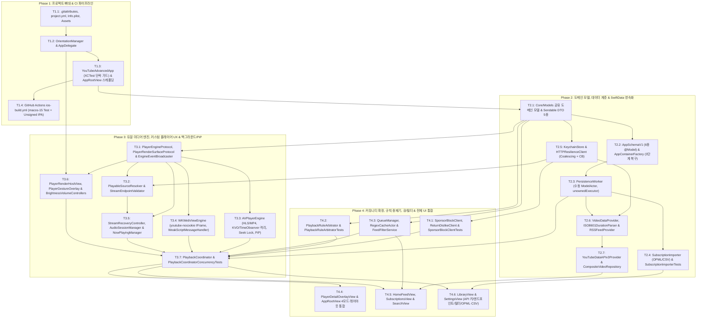

# iOS YouTube Advanced 클라이언트 상세 구현 태스크 명세서 (`TASKS.md`)

본 문서는 [`DESIGN.md`](file:///C:/data/KTJ/Program/advanced/DESIGN.md)의 아키텍처, 상세 인터페이스 계약 및 예외 방어 매트릭스(섹션 1~6)를 기반으로 Phase 1부터 Phase 4까지의 구현 작업을 의존성 순서에 따라 분해한 실행 명세서입니다.

---

## 0. 전체 의존성 그래프 (DAG) 및 크리티컬 패스 요약

### 0.1 태스크 의존성 다이어그램


### 0.2 크리티컬 패스 (Critical Path)
1. **빌드 & 테스트 파이프라인 개통 경로**: `T1.1` → `T1.2` → `T1.3` → `T1.4`
2. **코어 모델 & 영속화/네트워크 기반 경로**: `T2.1` → `T2.2` → `T2.3` 및 `T2.1` → `T2.5` → `T2.6` → `T2.7`
3. **도메인 규칙 & 듀얼 엔진 통합 경로**: `T3.1` → `T3.2`/`T3.3`/`T3.4`/`T3.5`/`T3.6` + `T4.1`/`T4.2`/`T4.3` → `T3.7`(`PlaybackCoordinator` + 동시성 테스트)
   - *참고*: `PlaybackCoordinator`(`T3.7`)는 생성자에서 `PlaybackRuleArbitrator`, `QueueManagerProtocol`, `SponsorBlockClientProtocol`, `ReturnDislikeClientProtocol`을 주입받으므로, 병렬 작업 시 `T2.1`/`T2.5` 완료 직후 `T4.1`~`T4.3`을 선행하거나 프로토콜/코어 로직을 함께 빌드한 뒤 `T3.7`에서 조립합니다.
4. **전체 화면 통합 및 사이드로딩 패키징 경로**: `T3.7` + `T2.7` + `T2.4` → `T4.4` / `T4.5` / `T4.6`

### 0.3 파일 경로 ↔ 태스크 1:1 매핑 검증표 (`DESIGN.md` 섹션 4 기준)

| 디렉토리 / 파일 경로 (`DESIGN.md` 섹션 4) | 담당 태스크 | Phase |
| :--- | :--- | :--- |
| `.gitattributes` | `T1.1` | Phase 1 |
| `project.yml` | `T1.1` | Phase 1 |
| `.github/workflows/ios-build.yml` | `T1.4` | Phase 1 |
| `App/YouTubeAdvancedApp.swift` | `T1.3` (스캐폴딩), `T2.2` (컨테이너 연결), `T4.4` (최종 DI 조립) | Phase 1~4 |
| `App/AppDelegate.swift` | `T1.2` | Phase 1 |
| `App/OrientationManager.swift` | `T1.2` | Phase 1 |
| `App/Info.plist` | `T1.1` | Phase 1 |
| `App/Assets.xcassets/Contents.json` | `T1.1` | Phase 1 |
| `App/Assets.xcassets/AccentColor.colorset/Contents.json` | `T1.1` | Phase 1 |
| `App/Assets.xcassets/AppIcon.appiconset/Contents.json` | `T1.1` | Phase 1 |
| `Core/Models/VideoModels.swift` | `T2.1` | Phase 2 |
| `Core/Models/StreamEndpointSettings.swift` | `T2.1` | Phase 2 |
| `Core/Models/PlaybackModels.swift` | `T2.1` | Phase 2 |
| `Core/Models/CommunityModels.swift` | `T2.1` | Phase 2 |
| `Core/Models/PersistenceDTOs.swift` | `T2.1` | Phase 2 |
| `Core/Persistence/AppSchemaV1.swift` | `T2.2` | Phase 2 |
| `Core/Persistence/PersistenceWorker.swift` | `T2.3` | Phase 2 |
| `Core/Persistence/SubscriptionImporter.swift` | `T2.4` | Phase 2 |
| `Core/Networking/KeychainStore.swift` | `T2.5` | Phase 2 |
| `Core/Networking/HTTPResilienceClient.swift` | `T2.5` | Phase 2 |
| `Core/Networking/VideoDataProvider.swift` | `T2.6` | Phase 2 |
| `Core/Networking/RSSFeedProvider.swift` | `T2.6` | Phase 2 |
| `Core/Networking/YouTubeDataAPIv3Provider.swift` | `T2.7` | Phase 2 |
| `Core/Networking/CompositeVideoRepository.swift` | `T2.7` | Phase 2 |
| `Core/Networking/SponsorBlockClient.swift` | `T4.1` | Phase 4 |
| `Core/Networking/ReturnDislikeClient.swift` | `T4.1` | Phase 4 |
| `Core/Domain/PlaybackCoordinator.swift` | `T3.7` | Phase 3 |
| `Core/Domain/PlaybackRuleArbitrator.swift` | `T4.2` | Phase 4 |
| `Core/Domain/QueueManager.swift` | `T4.3` | Phase 4 |
| `Core/Domain/FeedFilterService.swift` | `T4.3` | Phase 4 |
| `Core/Domain/RegexCacheActor.swift` | `T4.3` | Phase 4 |
| `MediaEngine/PlayerEngineProtocol.swift` | `T3.1` | Phase 3 |
| `MediaEngine/EngineEventBroadcaster.swift` | `T3.1` | Phase 3 |
| `MediaEngine/PlayableSourceResolver.swift` | `T3.2` | Phase 3 |
| `MediaEngine/AVPlayerEngine.swift` | `T3.3` | Phase 3 |
| `MediaEngine/WKWebViewEngine.swift` | `T3.4` | Phase 3 |
| `MediaEngine/StreamRecoveryController.swift` | `T3.5` | Phase 3 |
| `MediaEngine/AudioSessionManager.swift` | `T3.5` | Phase 3 |
| `MediaEngine/NowPlayingManager.swift` | `T3.5` | Phase 3 |
| `Features/Root/AppRootView.swift` | `T1.3` (스캐폴딩), `T4.4` (4모드 레이아웃 완성) | Phase 1, 4 |
| `Features/Root/PlayerRenderHostView.swift` | `T3.6` | Phase 3 |
| `Features/Player/PlayerGestureOverlay.swift` | `T3.6` | Phase 3 |
| `Features/Player/BrightnessVolumeControllers.swift` | `T3.6` | Phase 3 |
| `Features/Player/PlayerDetailOverlayView.swift` | `T4.4` | Phase 4 |
| `Features/Home/HomeFeedView.swift` | `T4.5` | Phase 4 |
| `Features/Subscriptions/SubscriptionsView.swift` | `T4.5` | Phase 4 |
| `Features/Search/SearchView.swift` | `T4.5` | Phase 4 |
| `Features/Library/LibraryView.swift` | `T4.6` | Phase 4 |
| `Features/Settings/SettingsView.swift` | `T4.6` | Phase 4 |
| `Tests/SubscriptionImporterTests.swift` | `T2.4` | Phase 2 |
| `Tests/PlaybackCoordinatorConcurrencyTests.swift` | `T3.7` | Phase 3 |
| `Tests/SponsorBlockClientTests.swift` | `T4.1` | Phase 4 |
| `Tests/PlaybackRuleArbitratorTests.swift` | `T4.2` | Phase 4 |

---

## 1. Phase 1: 프로젝트 뼈대 & CI 파이프라인 구축

### `T1.1`: Git 줄바꿈 정규화, XcodeGen `project.yml`, `App/Info.plist` 및 에셋 카탈로그 구성
- **우선순위 / 블로커 완화 노트**: **P0 (최우선 블로커 방지)**
  - `SWIFT_VERSION: "5.10"`은 유효한 Xcode 언어 모드가 아니므로 반드시 `SWIFT_VERSION: "5.0"` + `SWIFT_STRICT_CONCURRENCY: complete`를 사용합니다.
  - `project.yml`에서 `info:` 블록을 사용하면 `xcodegen generate`가 `App/Info.plist`를 덮어쓰므로 `info:` 블록을 배제하고 `GENERATE_INFOPLIST_FILE: YES` + `INFOPLIST_FILE: App/Info.plist` 병합 방식을 사용합니다.
  - `App/Info.plist` 내부에 `CFBundle*` 키를 중복 선언하면 Xcode 16 병합 충돌이 발생하므로 커스텀 키만 최상위에 선언합니다.
  - `YouTubeAdvancedTests` 타겟이 `@testable import YouTubeAdvanced`를 링크하고 `xcodebuild test -scheme YouTubeAdvanced`에서 실행되도록 `TEST_HOST`/`BUNDLE_LOADER` 및 `schemes.YouTubeAdvanced.test`를 명시합니다.
- **선행 의존성 (`Depends on`)**: 없음
- **대상 파일 (`Target Files`)**:
  - `.gitattributes`
  - `project.yml`
  - `App/Info.plist`
  - `App/Assets.xcassets/Contents.json`
  - `App/Assets.xcassets/AccentColor.colorset/Contents.json`
  - `App/Assets.xcassets/AppIcon.appiconset/Contents.json`
- **구체적 구현 범위 (`Concrete Scope`)**:
  1. `.gitattributes`: `*.swift`, `*.yml`, `*.yaml`, `*.plist`, `*.sh`, `*.json`, `*.opml`, `*.csv`에 대해 `text eol=lf` 강제(Windows 로컬 편집 시 CRLF 혼입 방지).
  2. `project.yml` (`DESIGN.md` 섹션 4.1.2 표준 명세 준수):
     - `deploymentTarget.iOS: "17.0"`, `xcodeVersion: "16.0"`, `SWIFT_VERSION: "5.0"`, `SWIFT_STRICT_CONCURRENCY: complete`, `CODE_SIGN_IDENTITY: ""`, `CODE_SIGNING_REQUIRED: NO`.
     - `YouTubeAdvanced` (`application`, iOS): `sources: [App, Core, MediaEngine, Features]`, `PRODUCT_BUNDLE_IDENTIFIER: com.personal.ytadvanced.app`, `MARKETING_VERSION: "1.0.0"`, `CURRENT_PROJECT_VERSION: "1"`, `GENERATE_INFOPLIST_FILE: YES`, `INFOPLIST_FILE: App/Info.plist`, `ASSETCATALOG_COMPILER_APPICON_NAME: AppIcon`, `ASSETCATALOG_COMPILER_GLOBAL_ACCENT_COLOR_NAME: AccentColor`, `TARGETED_DEVICE_FAMILY: "1"`, `Debug` 설정에 `ENABLE_TESTABILITY: YES`. (무료 Apple ID 3앱/주 10 App ID 제한 준수를 위해 App Extension 타겟 추가 금지).
     - `YouTubeAdvancedTests` (`bundle.unit-test`, iOS): `sources: [Tests]`, `dependencies: [{ target: YouTubeAdvanced }]`, `PRODUCT_BUNDLE_IDENTIFIER: com.personal.ytadvanced.tests`, `GENERATE_INFOPLIST_FILE: YES`, `TEST_HOST: "$(BUILT_PRODUCTS_DIR)/YouTubeAdvanced.app/$(BUNDLE_EXECUTABLE_FOLDER_PATH)/YouTubeAdvanced"`, `BUNDLE_LOADER: "$(TEST_HOST)"`.
     - `schemes.YouTubeAdvanced`: `build.targets` (`YouTubeAdvanced: all`, `YouTubeAdvancedTests: [test]`), `test.targets: [YouTubeAdvancedTests]`.
  3. `App/Info.plist` (최상위 키만 작성, `CFBundle*` 절대 금지):
     - `UILaunchScreen`: `{}`
     - `UISupportedInterfaceOrientations`: `UIInterfaceOrientationPortrait`, `UIInterfaceOrientationLandscapeLeft`, `UIInterfaceOrientationLandscapeRight`
     - `UIBackgroundModes`: `["audio"]`
     - `UIViewControllerBasedStatusBarAppearance`: `true`
     - `NSAppTransportSecurity`: `{ "NSAllowsLocalNetworking": true }`
     - `NSLocalNetworkUsageDescription`: `"로컬 네트워크의 스트림 서버에 연결하기 위해 권한이 필요합니다."` (ATS 내부 중첩 금지, 최상위 키로 분리)
  4. `App/Assets.xcassets`: 루트 `Contents.json`, `AccentColor.colorset/Contents.json`, `AppIcon.appiconset/Contents.json` (`1024x1024` universal iOS 슬롯 정의) 생성.
- **완료 기준 (`Acceptance Criteria`)**:
  - `xcodegen generate` 실행 시 경고/오류 없이 `YouTubeAdvanced.xcodeproj`와 공유 `YouTubeAdvanced` 스킴이 생성되어야 함.
  - `App/Info.plist`가 `xcodegen generate` 전후로 덮어써지지 않고, `plutil -lint App/Info.plist`를 통과해야 함.
- **검증 및 테스트 케이스 (`Verification / Unit Test Cases`)**:
  - `plutil -lint App/Info.plist` 유효성 검사 통과.
  - 빌드된 `YouTubeAdvanced.app/Info.plist`에 자동 생성된 `CFBundleIdentifier`, `CFBundleExecutable`, `CFBundleShortVersionString`과 커스텀 키(`UIBackgroundModes`, `NSLocalNetworkUsageDescription`, `NSAppTransportSecurity`)가 모두 정상 병합되어 있는지 확인.

---

### `T1.2`: `OrientationManager` 및 `AppDelegate` 화면 회전 직렬화 인프라 구축
- **우선순위 / 블로커 완화 노트**: **P0**
  - iOS 17에서 `UIDevice.current.setValue(..., forKey: "orientation")` KVC 호출은 금지/비권장이며, `UIWindowScene.requestGeometryUpdate(.iOS(interfaceOrientations:))`와 `AppDelegate.application(_:supportedInterfaceOrientationsFor:)`가 직렬화되지 않으면 풀스크린 전환 시 레이아웃 깨짐이 발생합니다.
- **선행 의존성 (`Depends on`)**: `T1.1`
- **대상 파일 (`Target Files`)**:
  - `App/OrientationManager.swift`
  - `App/AppDelegate.swift`
- **구체적 구현 범위 (`Concrete Scope`)**:
  1. `OrientationManager` (`@MainActor @Observable final class`):
     - `private(set) var allowedOrientations: UIInterfaceOrientationMask = .portrait`
     - `private(set) var isTransitioningOrientation: Bool = false`
     - `func lock(to mask: UIInterfaceOrientationMask, in windowScene: UIWindowScene?) async`:
       - `allowedOrientations = mask` 갱신 후 활성 `UIViewController.attemptRotationToDeviceOrientation()` 또는 `setNeedsUpdateOfSupportedInterfaceOrientations()` 호출.
       - `windowScene?.requestGeometryUpdate(.iOS(interfaceOrientations: mask))` 호출 및 에러 핸들러 로깅, 회전 애니메이션 구간 동안 `isTransitioningOrientation` 플래그로 중복 회전 요청 직렬화.
  2. `AppDelegate` (`@MainActor final class AppDelegate: NSObject, UIApplicationDelegate`):
     - 공유 `OrientationManager` 참조 보유.
     - `func application(_ application: UIApplication, supportedInterfaceOrientationsFor window: UIWindow?) -> UIInterfaceOrientationMask`에서 `orientationManager.allowedOrientations` 반환.
- **완료 기준 (`Acceptance Criteria`)**:
  - `SWIFT_STRICT_CONCURRENCY: complete` 하에서 `@MainActor` 격리 경고 없이 컴파일되어야 함.
  - 인라인/미니플레이어 모드에서는 `.portrait`, 풀스크린 진입 시에는 `.landscape` (또는 `.allButUpsideDown`) 마스크가 즉시 반영되어야 함.
- **검증 및 테스트 케이스 (`Verification / Unit Test Cases`)**:
  - `OrientationManager.lock(to: .landscape, in: nil)` 호출 시 `allowedOrientations == .landscape` 및 `AppDelegate.application(_:supportedInterfaceOrientationsFor:)` 반환값 일치 검증.

---

### `T1.3`: 앱 엔트리 포인트(`YouTubeAdvancedApp`) 테스트 호스트 단락 가드 및 루트 스캐폴딩
- **우선순위 / 블로커 완화 노트**: **P0 (Unit Test 오염 방지)**
  - `YouTubeAdvancedTests`는 `TEST_HOST`로 앱을 부팅하므로, 테스트 실행 시 프로덕션 SQLite 파일 잠금·오디오 세션 활성화·네트워크 요청이 실행되지 않도록 `XCTestConfigurationFilePath` 환경변수 감지 시 `EmptyView()`로 단락(Short-Circuit)해야 합니다.
- **선행 의존성 (`Depends on`)**: `T1.1`, `T1.2`
- **대상 파일 (`Target Files`)**:
  - `App/YouTubeAdvancedApp.swift`
  - `Features/Root/AppRootView.swift` (초기 스캐폴딩)
  - `Tests/SubscriptionImporterTests.swift` (Phase 1 CI 검증용 최소 스모크 테스트, `T2.4`에서 본 구현)
- **구체적 구현 범위 (`Concrete Scope`)**:
  1. `YouTubeAdvancedApp` (`@main struct YouTubeAdvancedApp: App`):
     - `@UIApplicationDelegateAdaptor(AppDelegate.self) private var appDelegate`
     - `private var isRunningUnitTests: Bool { ProcessInfo.processInfo.environment["XCTestConfigurationFilePath"] != nil }`
     - `body`: `isRunningUnitTests == true`이면 `WindowGroup { EmptyView() }`만 반환하고 프로덕션 컨테이너/코디네이터 초기화를 건너뜀. 일반 실행 시에는 `AppRootView()` 렌더링.
  2. `AppRootView` (Phase 1 초기 스캐폴딩):
     - 기본 `TabView`(홈/구독/검색/보관함/설정 플레이스홀더) 및 상단 비차단 배너 슬롯 구성(`T4.4`에서 단일 영속 `PlayerRenderHostView` 통합).
- **완료 기준 (`Acceptance Criteria`)**:
  - 시뮬레이터에서 `xcodebuild test` 실행 시 호스트 앱이 `EmptyView()`로 즉시 부팅되고 테스트 번들이 정상 로드되어야 함.
- **검증 및 테스트 케이스 (`Verification / Unit Test Cases`)**:
  - `XCTestConfigurationFilePath` 존재 시 `isRunningUnitTests == true` 분기 동작 확인.

---

### `T1.4`: GitHub Actions `macos-15` 시뮬레이터 단위 테스트 및 미서명 `.ipa` 아카이브 CI 파이프라인
- **우선순위 / 블로커 완화 노트**: **P0 (CI 실패 차단)**
  - `macos-14` 러너는 은퇴되었으므로 반드시 **`macos-15`**를 사용합니다.
  - `CODE_SIGNING_ALLOWED=NO`를 `xcodebuild test`에 전달하면 arm64 시뮬레이터에서 `xctest` 번들 로더 서명 검증 오류가 발생하므로, **`xcodebuild test`에는 서명 비활성화 플래그를 넘기지 않고 `xcodebuild archive`에만 전달**합니다.
  - 하드코딩된 시뮬레이터 이름 대신 `xcrun simctl list devices available -j`에서 동적으로 가용 iPhone UDID를 조회합니다.
- **선행 의존성 (`Depends on`)**: `T1.1`, `T1.2`, `T1.3`
- **대상 파일 (`Target Files`)**:
  - `.github/workflows/ios-build.yml`
- **구체적 구현 범위 (`Concrete Scope`)**:
  1. 트리거: `push` (`main`, `master`), `pull_request`, `workflow_dispatch`.
  2. `runs-on: macos-15`
  3. 단계(Steps):
     - Checkout (`actions/checkout@v4`)
     - XcodeGen 설치 및 프로젝트 생성: `brew install xcodegen && xcodegen generate`
     - `Info.plist` 문법 검증: `plutil -lint App/Info.plist`
     - 가용 iPhone 시뮬레이터 동적 탐색 및 단위 테스트 실행:
       ```bash
       SIM_UDID=$(xcrun simctl list devices available -j | python3 -c "import sys, json; data=json.load(sys.stdin)['devices']; print(next(d['udid'] for r in sorted(data.keys(), reverse=True) if 'iOS' in r for d in data[r] if 'iPhone' in d['name'] and d['isAvailable']))")
       xcodebuild test -project YouTubeAdvanced.xcodeproj -scheme YouTubeAdvanced -destination "platform=iOS Simulator,id=$SIM_UDID"
       ```
     - 미서명 Release 아카이브 생성:
       ```bash
       xcodebuild archive \
         -project YouTubeAdvanced.xcodeproj \
         -scheme YouTubeAdvanced \
         -configuration Release \
         -destination "generic/platform=iOS" \
         -archivePath "$RUNNER_TEMP/YouTubeAdvanced.xcarchive" \
         CODE_SIGN_IDENTITY="" \
         CODE_SIGNING_REQUIRED=NO \
         CODE_SIGNING_ALLOWED=NO \
         AD_HOC_CODE_SIGNING_ALLOWED=NO
       ```
     - `.ipa` 패키징 및 아티팩트 업로드:
       - `mkdir -p "$RUNNER_TEMP/ipa/Payload"`
       - `cp -R "$RUNNER_TEMP/YouTubeAdvanced.xcarchive/Products/Applications/YouTubeAdvanced.app" "$RUNNER_TEMP/ipa/Payload/YouTubeAdvanced.app"`
       - `rm -rf "$RUNNER_TEMP/ipa/Payload/YouTubeAdvanced.app/_CodeSignature" "$RUNNER_TEMP/ipa/Payload/YouTubeAdvanced.app/embedded.mobileprovision"`
       - `(cd "$RUNNER_TEMP/ipa" && zip -r -y "$GITHUB_WORKSPACE/YouTubeAdvanced-unsigned.ipa" Payload)`
       - `actions/upload-artifact@v4`로 `YouTubeAdvanced-unsigned.ipa` 업로드.
- **완료 기준 (`Acceptance Criteria`)**:
  - GitHub Actions `macos-15`에서 `xcodegen generate` → `xcodebuild test` → `xcodebuild archive` → `YouTubeAdvanced-unsigned.ipa` 생성까지 단일 워크플로우로 통과해야 함.
  - 생성된 `.ipa` 압축 해제 시 최상위에 `Payload/YouTubeAdvanced.app`이 위치해야 함(AltStore/SideStore/Sideloadly 호환).
- **검증 및 테스트 케이스 (`Verification / Unit Test Cases`)**:
  - `unzip -l YouTubeAdvanced-unsigned.ipa` 결과에 `Payload/YouTubeAdvanced.app/YouTubeAdvanced` 및 `Payload/YouTubeAdvanced.app/Info.plist` 존재 확인.

---

## 2. Phase 2: 도메인 모델, 데이터 계층 & SwiftData 영속화

### `T2.1`: 핵심 공유 도메인 모델 및 `Sendable` DTO 정의 (`Core/Models/`)
- **우선순위 / 블로커 완화 노트**: **P0**
  - 모든 모델과 DTO는 Swift 5 Strict Concurrency(`complete`) 하에서 액터 경계(`PersistenceWorker`, `HTTPResilienceClient`, `@MainActor` ViewModel)를 안전하게 넘나들 수 있도록 `Sendable` 및 `Equatable`을 준수해야 합니다.
  - `ABLoopRange`는 `pointB - pointA >= 1.0` 및 유한 값(`isFinite`, `pointA >= 0`) 가드를 생성자(`init?`)에서 강제하여 무한 시크 루프를 원천 차단합니다.
- **선행 의존성 (`Depends on`)**: `T1.3`
- **대상 파일 (`Target Files`)**:
  - `Core/Models/VideoModels.swift`
  - `Core/Models/StreamEndpointSettings.swift`
  - `Core/Models/PlaybackModels.swift`
  - `Core/Models/CommunityModels.swift`
  - `Core/Models/PersistenceDTOs.swift`
- **구체적 구현 범위 (`Concrete Scope`)**:
  1. `Core/Models/VideoModels.swift` (`DESIGN.md` 3.1.A.1):
     - `VideoPlayability` (`.playable`, `.live(concurrentViewers: Int?)`, `.upcoming(scheduledStart: Date?)`, `.restricted(RestrictionReason)` — `.privateOrDeleted`, `.regionBlocked`, `.ageRestricted`, `.embedDisabled`)
     - `VideoItem` (`id`, `title`, `channelId`, `channelTitle`, `duration: TimeInterval?`, `thumbnailURL: URL?`, `publishedAt: Date`, `playability: VideoPlayability`, `isShortHint: Bool?`)
     - `VideoPage` (`items: [VideoItem]`, `nextPageToken: String?`)
     - `PlayableSource` (`.direct(url: URL, format: DirectStreamFormat, headers: [String: String])`, `.webEmbed(videoID: String, baseURL: URL)`, `DirectStreamFormat`: `.hls`, `.muxedMP4`, `.audioOnly`, 헬퍼 프로퍼티 `var isDirect: Bool`)
     - `PlayerDisplayMode` (`.hidden`, `.inline`, `.miniPlayer`, `.fullscreen`)
  2. `Core/Models/StreamEndpointSettings.swift` (`DESIGN.md` 3.1.A.2):
     - `StreamEndpointKind` (`.webEmbedOnly`, `.pipedAPI`, `.invidiousAPI`, `.customTemplate`)
     - `StreamEndpointSettings` (`kind`, `endpointURLString`, `preferHLS`, `fallbackToWebEmbedOnFailure`)
  3. `Core/Models/PlaybackModels.swift` (`DESIGN.md` 3.1.A.3):
     - `DurationInfo` (`.unknown`, `.finite(TimeInterval)`, `.live(seekableRange: ClosedRange<TimeInterval>?)`, `var finiteSeconds: TimeInterval?`)
     - `PauseReason` (`.user`, `.audioSessionInterruption`, `.audioRouteDisconnected`, `.bufferingTimeout`)
     - `PlaybackState` (`.idle`, `.loading(loadID: UUID)`, `.playing`, `.paused(reason: PauseReason)`, `.buffering(wasPlaying: Bool)`, `.ended`, `.failed(PlaybackError)`)
     - `PlaybackError` (`.sourceResolutionFailed(String)`, `.streamExpired(httpStatus: Int)`, `.networkUnavailable`, `.unsupportedMediaFormat(osStatus: Int32)`, `.mediaServicesReset`, `.playbackFailed(domain: String, code: Int, message: String)`, `.webViewBridgeFailed(String)`)
     - `ABLoopRange` (`init?(pointA: TimeInterval, pointB: TimeInterval)` — `pointA.isFinite && pointB.isFinite && pointA >= 0 && (pointB - pointA) >= 1.0` 검증)
  4. `Core/Models/CommunityModels.swift` (`DESIGN.md` 3.1.A.4):
     - `SponsorCategory` (`sponsor`, `selfpromo`, `interaction`, `intro`, `outro`, `preview`, `musicOfftopic = "music_offtopic"`, `filler`, `poiHighlight = "poi_highlight"`)
     - `SponsorActionType` (`skip`, `mute`, `poi`, `full`)
     - `SponsorSegment`, `MergedSkipInterval`, `SponsorHighlightPoint`
     - `DislikeMetrics`, `DislikeState` (`.loading`, `.available(DislikeMetrics)`, `.unavailable`)
  5. `Core/Models/PersistenceDTOs.swift` (`DESIGN.md` 3.1.A.5):
     - `WatchHistoryDTO`, `SubscribedChannelDTO`, `BookmarkDTO`, `FilterTargetScope`, `FilterRuleDTO`, `PlaylistItemDTO`, `LocalPlaylistDTO`, `PersistenceChangeDomain`, `SubscriptionImportRowError`, `SubscriptionImportResult`
- **완료 기준 (`Acceptance Criteria`)**:
  - 5개 모델 파일 전체가 `SWIFT_STRICT_CONCURRENCY: complete` 경고/오류 0건으로 컴파일되어야 함.
- **검증 및 테스트 케이스 (`Verification / Unit Test Cases`)**:
  - `ABLoopRange(pointA: 10.0, pointB: 10.5) == nil` 및 `ABLoopRange(pointA: 10.0, pointB: 11.0) != nil` 검증.
  - `DurationInfo.finite(.nan).finiteSeconds == nil`, `DurationInfo.finite(.infinity).finiteSeconds == nil`, `DurationInfo.finite(120).finiteSeconds == 120` 검증.

---

### `T2.2`: SwiftData `AppSchemaV1` (6종 `@Model`) 및 `AppContainerFactory` 3단계 손상 복구 구현
- **우선순위 / 블로커 완화 노트**: **P0 (iOS 17 SwiftData 런타임 크래시 방지)**
  - iOS 17에서 V1 단일 스키마만 있을 때 `SchemaMigrationPlan(stages: [])`을 `ModelContainer`에 전달하면 런타임 크래시가 발생하므로 V1에서는 `migrationPlan` 인자를 생략하고 `Schema(versionedSchema: AppSchemaV1.self)`로만 생성합니다.
  - 무료 Apple ID에는 iCloud/App Group 엔타이틀먼트가 없으므로 `ModelConfiguration`에 반드시 `groupContainer: .none, cloudKitDatabase: .none`을 명시합니다.
  - 사이드로딩 재설치나 비정상 종료로 SQLite 파일이 손상되어도 앱이 `try!`로 죽지 않도록 3단계 복구(테스트 인메모리 단락 → 디스크 생성 → 손상 시 `.store/.store-shm/.store-wal` 삭제 후 1회 재시도 → 실패 시 인메모리 폴백 + 비차단 경고 플래그)를 구현합니다.
- **선행 의존성 (`Depends on`)**: `T2.1`
- **대상 파일 (`Target Files`)**:
  - `Core/Persistence/AppSchemaV1.swift`
  - `App/YouTubeAdvancedApp.swift` (`AppContainerFactory` 연결)
- **구체적 구현 범위 (`Concrete Scope`)**:
  1. `AppSchemaV1: VersionedSchema` (`versionIdentifier = Schema.Version(1, 0, 0)`):
     - `WatchHistoryEntity`: `@Attribute(.unique) var videoId: String`, `title: String`, `channelId: String`, `channelName: String`, `lastPosition: TimeInterval`, `duration: TimeInterval`, `watchedAt: Date`
     - `SubscribedChannelEntity`: `@Attribute(.unique) var channelId: String`, `name: String`, `avatarURLString: String?`, `addedAt: Date`, `lastSyncedAt: Date?`, `etag: String?`
     - `BookmarkEntity`: `@Attribute(.unique) var id: UUID`, `videoId: String`, `timestamp: TimeInterval`, `note: String`, `createdAt: Date`
     - `FilterRuleEntity`: `@Attribute(.unique) var id: UUID`, `keyword: String`, `isRegex: Bool`, `targetScopeRaw: String`, `isEnabled: Bool`
     - `LocalPlaylistEntity`: `@Attribute(.unique) var id: UUID`, `name: String`, `createdAt: Date`, `@Relationship(deleteRule: .cascade, inverse: \PlaylistItemEntity.playlist) var items: [PlaylistItemEntity]`
     - `PlaylistItemEntity`: `var videoId: String`, `title: String`, `sortOrder: Int`, `addedAt: Date`, `var playlist: LocalPlaylistEntity?`
  2. `AppContainerBootstrapResult` & `AppContainerFactory`:
     - `struct AppContainerBootstrapResult: Sendable { let container: ModelContainer; let didRecoverFromCorruptedStore: Bool; let isFallbackInMemory: Bool }`
     - `static func makeContainer(forceInMemory: Bool = false, storeURL: URL? = nil) -> AppContainerBootstrapResult`:
       - 1단계: `forceInMemory == true` 또는 `XCTestConfigurationFilePath != nil` 시 `ModelConfiguration(schema: schema, isStoredInMemoryOnly: true, groupContainer: .none, cloudKitDatabase: .none)` 반환.
       - 2단계: 디스크 `ModelConfiguration("YouTubeAdvancedStore", schema: schema, isStoredInMemoryOnly: false, allowsSave: true, groupContainer: .none, cloudKitDatabase: .none)` 시도.
       - 3단계: 실패 시 스토어 URL의 `.store`, `.store-shm`, `.store-wal` 파일 삭제 후 1회 재시도(`didRecoverFromCorruptedStore = true`), 재실패 시 인메모리 컨테이너 폴백(`isFallbackInMemory = true`).
- **완료 기준 (`Acceptance Criteria`)**:
  - `AppContainerFactory.makeContainer(forceInMemory: true)` 및 디스크 생성/손상 파일 복구 경로가 `try!` 없이 항상 유효한 `ModelContainer`를 반환해야 함.
- **검증 및 테스트 케이스 (`Verification / Unit Test Cases`)**:
  - 임시 디렉토리에 잘못된 바이트(`Data("corrupted".utf8)`)가 담긴 `.store` 파일을 미리 생성한 뒤 `AppContainerFactory.makeContainer(storeURL:)` 호출 시 크래시 없이 손상 파일을 삭제하고 정상 컨테이너(`didRecoverFromCorruptedStore == true`)를 반환하는지 검증.

---

### `T2.3`: 수동 `ModelActor` 기반 `PersistenceWorker` 구현 (`Core/Persistence/PersistenceWorker.swift`)
- **우선순위 / 블로커 완화 노트**: **P0 (스레드 친화성 크래시 및 `@Unique` 덮어쓰기 방지)**
  - `@ModelActor` 매크로 없이 수동으로 `ModelActor`를 구현할 때 `nonisolated var unownedExecutor: UnownedSerialExecutor { modelExecutor.asUnownedSerialExecutor() }`를 빠뜨리면 기본 액터 풀에서 `ModelContext`가 실행되어 크래시가 발생합니다.
  - `context.autosaveEnabled = false`를 설정하고 `FetchDescriptor(..., fetchLimit: 1)`를 통한 명시적 조회 후 수정/삽입(Upsert)과 `try modelContext.save()`를 수행합니다.
  - iOS 17에서 백그라운드 `ModelActor` 저장이 SwiftUI `@Query`를 자동 갱신하지 못하는 문제를 해결하기 위해 `AsyncStream<PersistenceChangeDomain>`으로 변경 도메인을 브로드캐스트합니다.
- **선행 의존성 (`Depends on`)**: `T2.1`, `T2.2`
- **대상 파일 (`Target Files`)**:
  - `Core/Persistence/PersistenceWorker.swift`
- **구체적 구현 범위 (`Concrete Scope`)**:
  1. `PersistenceWorkerProtocol: Sendable` 및 `actor PersistenceWorker: ModelActor, PersistenceWorkerProtocol` (`DESIGN.md` 3.1.D.4 명세와 100% 동일한 시그니처):
     - `nonisolated let modelExecutor: any ModelExecutor`
     - `nonisolated let modelContainer: ModelContainer`
     - `nonisolated var unownedExecutor: UnownedSerialExecutor { modelExecutor.asUnownedSerialExecutor() }`
     - `init(modelContainer: ModelContainer)`: `let context = ModelContext(modelContainer); context.autosaveEnabled = false`
  2. 도메인별 CRUD 및 Upsert 구현:
     - **시청 기록 (`WatchHistory`)**: `upsertWatchHistory(_:)`, `fetchWatchPosition(videoId:)`, `fetchRecentWatchHistory(limit:)` (`watchedAt` 내림차순).
     - **구독 채널 (`Subscriptions`)**: `upsertSubscriptions(_:)` (기존 `addedAt`/`etag`/`lastSyncedAt` 보존 병합), `fetchSubscriptions()`, `deleteSubscription(channelId:)`.
     - **북마크 (`Bookmarks`)**: `addBookmark(_:)`, `fetchBookmarks(videoId:)` (`timestamp` 오름차순), `deleteBookmark(id:)`.
     - **필터 규칙 (`FilterRules`)**: `upsertFilterRule(_:)`, `fetchFilterRules()`, `deleteFilterRule(id:)`.
     - **로컬 재생목록 (`Playlists`)**: `createPlaylist(name:)`, `addVideoToPlaylist(playlistId:videoId:title:)` (현재 `max(sortOrder) + 1` 부여), `reorderPlaylistItems(playlistId:orderedVideoIds:)` (`sortOrder` 재할당), `fetchPlaylists()` (`items`를 반드시 `sortOrder` 오름차순 정렬하여 `LocalPlaylistDTO` 변환), `deletePlaylist(id:)`.
  3. 멀티 구독자 `changeStream() -> AsyncStream<PersistenceChangeDomain>`:
     - 각 `modelContext.save()` 성공 직후 활성 continuation들에 해당 `PersistenceChangeDomain`을 `yield`.
- **완료 기준 (`Acceptance Criteria`)**:
  - 인메모리 `ModelContainer` 기반에서 6종 엔티티의 Upsert, 조회, 정렬(`PlaylistItemDTO.sortOrder`), 삭제 및 `changeStream()` 이벤트 방출이 정상 동작해야 함.
- **검증 및 테스트 케이스 (`Verification / Unit Test Cases`)**:
  - 동일 `videoId`로 `upsertWatchHistory` 2회 호출 시 레코드가 중복 생성되지 않고 `lastPosition`과 `watchedAt`만 갱신되는지 검증.
  - `reorderPlaylistItems` 호출 후 `fetchPlaylists()` 반환 항목의 `sortOrder` 및 배열 순서가 정확히 일치하는지 검증.

---

### `T2.4`: OPML & YouTube Takeout CSV 구독 임포터 및 단위 테스트
- **우선순위 / 블로커 완화 노트**: **P1**
  - iOS 파일 선택기(`fileImporter`)에서 `.opml` 확장자 인식 누락을 막기 위해 `UTType(filenameExtension: "opml") ?? .xml`을 지원하고, `startAccessingSecurityScopedResource()` / `defer { stopAccessingSecurityScopedResource() }`를 준수합니다.
  - YouTube Takeout CSV는 UTF-8 BOM(`0xEF, 0xBB, 0xBF`), 채널명에 포함된 쉼표(`,`)와 이스케이프된 큰따옴표(`""`), 다국어 헤더 변형이 존재하므로 단순 `components(separatedBy: ",")` 대신 RFC 4180 상태 머신 파서를 구현합니다.
- **선행 의존성 (`Depends on`)**: `T2.1`, `T2.3`
- **대상 파일 (`Target Files`)**:
  - `Core/Persistence/SubscriptionImporter.swift`
  - `Tests/SubscriptionImporterTests.swift`
- **구체적 구현 범위 (`Concrete Scope`)**:
  1. `SubscriptionImporterProtocol: Sendable` 및 `struct SubscriptionImporter: SubscriptionImporterProtocol`:
     - `init(persistence: any PersistenceWorkerProtocol)`
     - `importOPML(data: Data) async throws -> SubscriptionImportResult`:
       - `XMLParserDelegate` 헬퍼를 통해 `<outline>` 태그의 `xmlUrl`에서 `channel_id=UC[A-Za-z0-9_-]{22}` 추출, `title` 또는 `text` 속성에서 채널명 추출.
     - `importTakeoutCSV(data: Data) async throws -> SubscriptionImportResult`:
       - 선두 UTF-8 BOM(`\u{FEFF}`) 제거.
       - RFC 4180 상태 머신(`inQuotes`, `""` 이스케이프, CRLF/LF 줄바꿈)으로 행/열 분리.
       - 헤더 행 자동 판별(영문 `Channel ID`/`Channel Title` 및 한국어 `채널 ID`/`채널 제목` 등) 또는 첫 번째 컬럼에서 `^UC[A-Za-z0-9_-]{22}$` 정규식 검증.
       - 유효하지 않은 행은 중단하지 않고 `SubscriptionImportRowError(lineOrElementIndex:rawValue:reason:)`에 수집, 배치 내 중복 `channelId` 및 기존 DB 구독과 비교하여 `importedCount`/`duplicateSkippedCount` 집계 후 `persistence.upsertSubscriptions(_:)` 호출.
     - `importFromFileURL(_ url: URL) async throws -> SubscriptionImportResult`:
       - 보안 스코프 리소스 접근 가드 적용 및 확장자/콘텐츠 기반 OPML vs CSV 자동 분기.
  2. `Tests/SubscriptionImporterTests.swift`:
     - 정상/중첩 `<outline>` OPML 파싱 및 잘못된 `xmlUrl` 부분 실패 리포트 검증.
     - UTF-8 BOM + 따옴표/쉼표 포함 채널명(`"Tech, ""Pro"" & More"`) CSV 파싱 검증.
     - 중복 `channelId` 스킵 카운트(`duplicateSkippedCount`) 및 손상된 행(`failedRows`) 격리 검증.
- **완료 기준 (`Acceptance Criteria`)**:
  - `xcodebuild test`에서 `SubscriptionImporterTests`의 모든 테스트 케이스가 100% 통과해야 함.
- **검증 및 테스트 케이스 (`Verification / Unit Test Cases`)**:
  - `testImportOPML_ValidAndMalformedOutlines_ReportsPartialFailures()`
  - `testImportTakeoutCSV_WithUTF8BOMAndEscapedQuotes_ParsesAccurately()`
  - `testImportTakeoutCSV_DuplicateChannelIds_SkipsAndCountsDuplicates()`

---

### `T2.5`: 리사이닝 호환 `KeychainStore` 및 취소 안전 Coalescing·Circuit Breaker `HTTPResilienceClient` 구현
- **우선순위 / 블로커 완화 노트**: **P0**
  - 무료 Apple ID 사이드로딩(AltStore/SideStore) 시 번들 ID가 리사이닝 도구에 의해 변경되므로 Keychain Access Group(`kSecAttrAccessGroup`)을 절대 지정하지 않고 `kSecAttrAccessibleAfterFirstUnlockThisDeviceOnly`만 사용합니다.
  - `HTTPResilienceClient`의 In-Flight Coalescing에서 첫 번째 호출자 `Task`가 취소될 때 같은 URL을 대기 중인 두 번째 호출자까지 실패하는 연쇄 취소 버그를 막기 위해, 비구조적 공유 `Task` + `subscriberCount` 참조 카운팅을 구현합니다.
- **선행 의존성 (`Depends on`)**: `T2.1`
- **대상 파일 (`Target Files`)**:
  - `Core/Networking/KeychainStore.swift`
  - `Core/Networking/HTTPResilienceClient.swift`
- **구체적 구현 범위 (`Concrete Scope`)**:
  1. `KeychainStore` (`Core/Networking/KeychainStore.swift`):
     - `protocol KeychainStoreProtocol: Sendable` (`loadAPIKey() -> String?`, `saveAPIKey(_ key: String) throws`, `deleteAPIKey() throws`, `onAPIKeyChanged: AsyncStream<Void>`)
     - Security 프레임워크 `SecItemCopyMatching` / `SecItemAdd` / `SecItemUpdate` / `SecItemDelete` 래퍼 (`kSecClassGenericPassword`, `kSecAttrAccount: "youtube_data_api_v3_key"`, `kSecAttrAccessibleAfterFirstUnlockThisDeviceOnly`, Access Group 미사용).
     - 단위 테스트용 `InMemoryKeychainStore` 함께 제공.
  2. `HTTPTransportProtocol` & `HTTPResilienceClient` (`Core/Networking/HTTPResilienceClient.swift`):
     - `protocol HTTPTransportProtocol: Sendable { func data(for request: URLRequest) async throws -> (Data, HTTPURLResponse) }` 및 `URLSession: HTTPTransportProtocol` 확장 (`DESIGN.md` 3.1.D.1).
     - `actor HTTPResilienceClient`:
       - `init(transport: any HTTPTransportProtocol = URLSession.shared, now: @escaping @Sendable () -> Date = { Date() })`
       - **In-Flight Coalescing**: 동일 `GET` 요청 키(`url.absoluteString + headersHash`)에 대해 `InFlightEntry(task: Task<(Data, HTTPURLResponse), Error>, subscribers: Set<UUID>)` 관리. 개별 호출자 취소(`withTaskCancellationHandler`) 시 `subscribers.remove(id)` 후 `subscribers.isEmpty`일 때만 내부 네트워크 `task.cancel()` 수행.
       - **Circuit Breaker**: 호스트별 연속 실패 횟수(`consecutiveFailures`) 추적. `5xx` 상태 코드 또는 `URLError.timedOut`이 연속 3회 발생하면 `openedUntil = now().addingTimeInterval(300)`(5분) 설정. `open` 상태에서 요청 시 네트워크 호출 없이 즉시 `HTTPResilienceError.circuitBreakerOpen(host:retryAfter:)` throw. 5분 경과 후 `halfOpen` 프로브 1회 성공 시 `closed`로 초기화.
- **완료 기준 (`Acceptance Criteria`)**:
  - 동시 `GET` 요청 2개 중 1개가 취소되어도 나머지 1개는 정상 응답을 수신해야 함.
  - 연속 3회 `503`/`timedOut` 발생 후 4번째 요청이 네트워크 전송 없이 즉시 Circuit Breaker 오류로 차단되고, 가상 시계(`now`)를 +301초 전진시키면 프로브 요청이 허용되어야 함.
- **검증 및 테스트 케이스 (`Verification / Unit Test Cases`)**:
  - `HTTPResilienceClient`의 Coalescing 부분 취소 보존 및 5분 Circuit Breaker 상태 전이는 `SponsorBlockClientTests`(`T4.1`)에서 `MockHTTPTransport`와 주입된 `now` 클로저로 함께 검증.

---

### `T2.6`: `VideoDataProvider` 계약, `ISO8601DurationParser` 및 디스크 캐시 기반 `RSSFeedProvider` 구현
- **우선순위 / 블로커 완화 노트**: **P0**
  - `XMLParserDelegate`는 `NSObjectProtocol`을 요구하므로 `actor RSSFeedProvider`가 직접 채택하면 Swift 5 Strict Concurrency 격리 충돌이 발생합니다. 반드시 호출마다 생성되는 `nonisolated final class RSSAtomParserHelper: NSObject, XMLParserDelegate`로 분리합니다.
  - `ETag`/`304 Not Modified`가 앱 재실행 후에도 유지되도록 `FileManager.cachesDirectory/RSSCache/{channelId}.json` 디스크 캐시(Soft TTL 15분, SWR 24시간)를 구현합니다.
- **선행 의존성 (`Depends on`)**: `T2.1`, `T2.3`, `T2.5`
- **대상 파일 (`Target Files`)**:
  - `Core/Networking/VideoDataProvider.swift`
  - `Core/Networking/RSSFeedProvider.swift`
- **구체적 구현 범위 (`Concrete Scope`)**:
  1. `Core/Networking/VideoDataProvider.swift` (`DESIGN.md` 3.1.D.2):
     - `VideoDataError` (`.quotaExceeded(resetAt: Date)`, `.invalidAPIKey`, `.channelNotFound(String)`, `.httpError(statusCode: Int, message: String)`, `.networkUnavailable`, `.parsingFailed(String)`)
     - `protocol VideoDataProvider: Sendable` (`fetchChannelFeed(channelId:forceRefresh:)`, `fetchVideoDetails(videoIds:)`, `searchVideos(query:pageToken:)`, `resolveChannelId(fromInput:)`)
     - `struct ISO8601DurationParser`:
       - 정규식 `^P(?:(\d+)D)?(?:T(?:(\d+)H)?(?:(\d+)M)?(?:(\d+)S)?)?$`로 `PT1H2M30S`, `PT45S`, `P1DT2H`, `P0D` 파싱.
       - `static func parse(_ raw: String, isLiveOrUpcoming: Bool = false) -> TimeInterval?`: 총 초(`days*86400 + hours*3600 + minutes*60 + seconds`) 계산, `total == 0 && isLiveOrUpcoming`이거나 매칭 실패 시 `nil` 반환.
  2. `Core/Networking/RSSFeedProvider.swift`:
     - `actor RSSFeedProvider`:
       - 디스크 캐시 엔트리(`RSSDiskCacheEntry: Codable, Sendable` — `items: [VideoItem]`, `etag: String?`, `lastModified: String?`, `cachedAt: Date`).
       - `forceRefresh == false`이고 `now - cachedAt < 900`(15분 Soft TTL)이면 네트워크 요청 없이 디스크 캐시 즉시 반환.
       - 조건부 요청(`If-None-Match: etag`, `If-Modified-Since: lastModified`) 전송 → HTTP `304` 수신 시 디스크 캐시의 `cachedAt`만 갱신 후 캐시된 `items` 반환.
       - 네트워크 실패 시 `now - cachedAt < 86400`(24시간 SWR) 내 캐시가 존재하면 폴백 반환.
       - `func fetchMultipleChannelFeeds(channelIds: [String], forceRefresh: Bool) async -> [VideoItem]`: `withThrowingTaskGroup` 슬라이딩 윈도우 패턴으로 **최대 동시 요청 수 4개** 제한 후 `publishedAt` 내림차순 병합.
     - `nonisolated final class RSSAtomParserHelper: NSObject, XMLParserDelegate`:
       - `<entry>` 내 `<yt:videoId>`, `<yt:channelId>`, `<title>`, `<author><name>`, `<published>`, `<media:group><media:thumbnail>`, `<link rel="alternate">`(`/shorts/` 포함 시 `isShortHint = true`) 추출.
- **완료 기준 (`Acceptance Criteria`)**:
  - `ISO8601DurationParser`가 표준/엣지 케이스(`PT59S`, `PT1H0M0S`, `P1DT12H`, `P0D`)를 정확히 변환해야 함.
  - `RSSFeedProvider`가 HTTP `200` 응답 후 디스크에 캐시를 기록하고, 후속 요청에서 `If-None-Match` 전송 및 `304` 수신 시 캐시 데이터를 반환해야 함.
- **검증 및 테스트 케이스 (`Verification / Unit Test Cases`)**:
  - `ISO8601DurationParser.parse("PT1H2M30S") == 3750`, `parse("P0D", isLiveOrUpcoming: true) == nil` 확인.
  - YouTube Atom XML 샘플 파싱 및 `/shorts/` 링크 `isShortHint == true` 매핑 확인.

---

### `T2.7`: `YouTubeDataAPIv3Provider` (50개 배치 조회, LA 타임존 자정 쿼터 리셋) 및 `CompositeVideoRepository` 하이브리드 조합
- **우선순위 / 블로커 완화 노트**: **P1**
  - YouTube Data API v3 일일 할당량(10,000 units)은 UTC나 로컬 시간이 아닌 **태평양 표준시(`America/Los_Angeles`) 자정(00:00:00 PT)**에 리셋됩니다.
  - 또한 사용자가 설정에서 새 API 키로 교체하면 `quotaResetAt` 차단을 즉시 해제해야 합니다.
  - 사이드로딩 리사이닝 시 API 키의 iOS 번들 ID 제한과 호환되도록 모든 요청에 `X-Ios-Bundle-Identifier: Bundle.main.bundleIdentifier ?? ""` 헤더를 첨부합니다.
- **선행 의존성 (`Depends on`)**: `T2.5`, `T2.6`
- **대상 파일 (`Target Files`)**:
  - `Core/Networking/YouTubeDataAPIv3Provider.swift`
  - `Core/Networking/CompositeVideoRepository.swift`
- **구체적 구현 범위 (`Concrete Scope`)**:
  1. `YouTubeDataAPIv3Provider` (`actor`):
     - `init(httpClient: HTTPResilienceClient, keychain: any KeychainStoreProtocol, now: @escaping @Sendable () -> Date = { Date() })`
     - **할당량 차단 & LA 자정 리셋**:
       - HTTP `403` 응답 JSON에서 `error.errors[].reason`이 `"quotaExceeded"` 또는 `"dailyLimitExceeded"`이면 `Calendar(identifier: .gregorian)` + `TimeZone(identifier: "America/Los_Angeles")!` 기준 다음 날 `00:00:00` 시각을 `quotaResetAt`으로 설정하고 `VideoDataError.quotaExceeded(resetAt:)` throw.
       - `notifyAPIKeyUpdated()` 호출(또는 `keychain`의 키 해시 변경 감지) 시 즉시 `quotaResetAt = nil` 초기화.
     - **배치 상세 조회 (`fetchVideoDetails(videoIds:)`)**:
       - 입력 `videoIds`를 50개 단위 청크로 분할(`videos.list?part=snippet,contentDetails,status,liveStreamingDetails&id={50Ids}`, 청크당 1 unit).
       - `ISO8601DurationParser`로 `duration` 파싱 및 `VideoPlayability` 매핑(`privacyStatus == "private"` → `.restricted(.privateOrDeleted)`, `embeddable == false` → `.restricted(.embedDisabled)`, `ytRating == "ytAgeRestricted"` → `.restricted(.ageRestricted)`, `liveBroadcastContent == "live"` → `.live(...)`, `"upcoming"` → `.upcoming(...)`, 그 외 `.playable`).
     - **검색 (`searchVideos(query:pageToken:)`)**:
       - `search.list(part=snippet&type=video&maxResults=25)` 호출 후 반환된 `videoId` 목록을 `fetchVideoDetails` 1회 배치(1 unit)로 보강하여 정확한 `duration`과 `playability`가 채워진 `VideoPage` 반환.
     - **채널 ID 해석 (`resolveChannelId(fromInput:)`)**:
       - 이미 `UC[A-Za-z0-9_-]{22}` 형태이면 `0 unit`으로 즉시 반환.
       - `@handle` 또는 채널 URL이면 `channels.list(part=id&forHandle=...)` (1 unit) 호출.
  2. `CompositeVideoRepository: VideoDataProvider`:
     - 구독/채널 피드는 항상 `RSSFeedProvider` (`0 unit`)를 우선 호출.
     - API 키가 존재하고 쿼터 차단 상태가 아닐 때만 `duration == nil`인 항목들을 모아 50개 단위 `YouTubeDataAPIv3Provider.fetchVideoDetails`로 메타데이터(길이/라이브 여부)를 보강하며, API 키 미설정 또는 `quotaExceeded` 시에도 RSS 피드만으로 정상 표시되도록 Graceful Degradation 보장.
- **완료 기준 (`Acceptance Criteria`)**:
  - API 키가 없거나 `quotaExceeded` 상태일 때도 `CompositeVideoRepository.fetchChannelFeed`가 에러를 던지지 않고 RSS 기반 `[VideoItem]`을 반환해야 함.
  - `quotaResetAt`이 `America/Los_Angeles` 타임존 기준 다음 날 자정(썸머타임 PDT/표준시 PST 자동 반영)으로 정확히 계산되어야 함.
- **검증 및 테스트 케이스 (`Verification / Unit Test Cases`)**:
  - `2026-07-15T22:00:00Z` (PDT 15:00) 기준 `quotaResetAt`이 `2026-07-16T07:00:00Z` (PDT 00:00)로 계산되는지 확인.
  - 75개 `videoIds` 입력 시 `videos.list`가 50개 + 25개 총 2회 배치로 분할 호출되는지 확인.

---

## 3. Phase 3: 듀얼 미디어 엔진, 커스텀 플레이어 UX & 백그라운드/PiP

### `T3.1`: `PlayerEngineProtocol`, `PlayerRenderSurfaceProtocol` 및 멀티캐스트 `EngineEventBroadcaster` 구현
- **우선순위 / 블로커 완화 노트**: **P0 (역방향 의존 제거 & 다중 소비자 이벤트 유실 방지)**
  - `MediaEngine`이 SwiftUI 뷰(`PlayerRenderHostView`)에 의존하지 않도록 `@MainActor protocol PlayerRenderSurfaceProtocol`을 분리하여 단위 테스트에서 `MockRenderSurface`를 주입할 수 있게 합니다.
  - 단일 `AsyncStream`은 복수 소비자(`PlaybackCoordinator`, `PlaybackRuleArbitrator`, UI 오버레이)가 동시에 `for await`할 때 이벤트가 유실되므로, 구독자별 독립 `AsyncStream`을 생성·브로드캐스트하는 `@MainActor final class EngineEventBroadcaster`를 구현합니다.
- **선행 의존성 (`Depends on`)**: `T2.1`
- **대상 파일 (`Target Files`)**:
  - `MediaEngine/PlayerEngineProtocol.swift`
  - `MediaEngine/EngineEventBroadcaster.swift`
- **구체적 구현 범위 (`Concrete Scope`)**:
  1. `MediaEngine/PlayerEngineProtocol.swift` (`DESIGN.md` 3.1.C.1 전체 타입/시그니처 100% 구현):
     - `ActiveRenderSurface` (`.none`, `.avPlayerLayer`, `.webView`)
     - `@MainActor protocol PlayerRenderSurfaceProtocol: AnyObject` (`var playerLayer: AVPlayerLayer { get }`, `func attachWebView(_ webView: WKWebView)`, `func setActiveSurface(_ surface: ActiveRenderSurface)`)
     - `EngineCapabilities: OptionSet, Sendable` (`.arbitraryPlaybackRate`, `.nativePiP`, `.backgroundAudio`, `.qualitySelection`, `.audioTrackSelection`, `.precisionBoundaries`, `.managesNowPlaying`)
     - `QualityOption`, `AudioTrackOption`, `PlaybackEngineEvent`, `SeekPrecision`
     - `@MainActor protocol PlayerEngineProtocol: AnyObject`
  2. `MediaEngine/EngineEventBroadcaster.swift`:
     - `@MainActor final class EngineEventBroadcaster`:
       - `private var continuations: [UUID: AsyncStream<PlaybackEngineEvent>.Continuation] = [:]`
       - `func makeStream() -> AsyncStream<PlaybackEngineEvent>`: 신규 `UUID` 발급, `onTermination` 시 `Task { @MainActor [weak self] in self?.continuations.removeValue(forKey: id) }` 정리.
       - `func send(_ event: PlaybackEngineEvent)`: 등록된 모든 continuation에 `yield(event)`.
       - `func finishAll()`: 모든 continuation 종료 및 딕셔너리 초기화.
- **완료 기준 (`Acceptance Criteria`)**:
  - `EngineEventBroadcaster`에 3개의 독립 소비자 태스크가 구독 중일 때 모든 소비자가 동일한 `PlaybackEngineEvent` 시퀀스를 누락 없이 수신해야 함.
- **검증 및 테스트 케이스 (`Verification / Unit Test Cases`)**:
  - 소비자 1개가 `cancel()`되어도 나머지 소비자의 스트림 수신이 정상 유지되는지 검증.

---

### `T3.2`: `PlayableSourceResolver` 및 `StreamEndpointValidator` 구현 (`MediaEngine/PlayableSourceResolver.swift`)
- **우선순위 / 블로커 완화 노트**: **P0 (스트림 해석 계층 & ATS 로컬 네트워크 보안)**
  - 원격 엔드포인트는 `https://`만 허용하고, `http://`는 `localhost`, `127.0.0.1`, `::1`, `.local`, 또는 RFC 1918 사설 IPv4 대역(`10.0.0.0/8`, `172.16.0.0/12`, `192.168.0.0/16`)에만 허용하도록 `StreamEndpointValidator`로 검증합니다.
  - 초기 로드(`bypassCache == false`)에서 직접 스트림 해석 실패 시 `settings.fallbackToWebEmbedOnFailure == true`이면 `.webEmbed`로 즉시 폴백하고, `StreamRecoveryController`가 호출하는 재발급(`bypassCache == true`)에서는 `PlaybackError.sourceResolutionFailed`를 throw하여 복구 재시도 횟수가 정확히 카운트되도록 분기합니다.
- **선행 의존성 (`Depends on`)**: `T2.1`, `T2.5`, `T3.1`
- **대상 파일 (`Target Files`)**:
  - `MediaEngine/PlayableSourceResolver.swift`
- **구체적 구현 범위 (`Concrete Scope`)**:
  1. `StreamResolverProtocol: Sendable` (`resolve(video:bypassCache:)`, `updateSettings(_:)`)
  2. `struct StreamEndpointValidator`:
     - `static func validate(urlString: String) throws -> URL`: URL 파싱, 스킴 검증(`https` 또는 허용된 로컬 `http` 호스트/RFC 1918 IPv4 옥텟 검사).
  3. `actor PlayableSourceResolver: StreamResolverProtocol`:
     - 단기 메모리 캐시(`videoID -> (source: PlayableSource, resolvedAt: Date)`, TTL 10분). `bypassCache == true` 시 캐시 무시 및 무효화.
     - `StreamEndpointKind`별 해석:
       - `.webEmbedOnly`: `.webEmbed(videoID: video.id, baseURL: URL(string: "https://www.youtube-nocookie.com")!)`
       - `.pipedAPI`: `GET {baseURL}/streams/{video.id}` (타임아웃 `3.5s`) → `preferHLS` 시 `hls` URL(`.hls`), 없으면 `videoStreams` 중 `videoOnly == false && format == "MPEG_4"` 최고 해상도(`.muxedMP4`).
       - `.invidiousAPI`: `GET {baseURL}/api/v1/videos/{video.id}` (타임아웃 `3.5s`) → `hlsUrl`(`.hls`) 또는 `formatStreams` 중 `container == "mp4"`(`.muxedMP4`).
       - `.customTemplate`: `{videoId}` 치환 후 `.m3u8` 여부에 따라 `.hls` / `.muxedMP4` 반환.
- **완료 기준 (`Acceptance Criteria`)**:
  - 공인 원격 HTTP URL(`http://example.com`)은 `StreamEndpointValidator`에서 거부되고, 사설 IP(`http://192.168.1.50:8080`, `http://172.16.0.5:3000`, `http://10.0.0.2`) 및 원격 HTTPS(`https://pipedapi.example.com`)는 통과해야 함.
- **검증 및 테스트 케이스 (`Verification / Unit Test Cases`)**:
  - `172.15.0.1`(비사설) HTTP 거부 vs `172.16.0.1`~`172.31.255.255`(사설) HTTP 허용 경계값 검증.
  - `bypassCache == false` vs `bypassCache == true` 실패 시 `.webEmbed` 폴백 vs `PlaybackError.sourceResolutionFailed` throw 동작 검증.

---

### `T3.3`: 네이티브 `AVPlayerEngine` 구현 (`MediaEngine/AVPlayerEngine.swift`)
- **우선순위 / 블로커 완화 노트**: **P0 (Swift 5 Strict Concurrency & AVFoundation 크래시 차단)**
  - `addBoundaryTimeObserver`에 빈 배열(`times.isEmpty`)을 전달하면 `NSInvalidArgumentException` 크래시가 발생하므로 반드시 `guard !times.isEmpty else { return }`를 선행합니다.
  - `addBoundaryTimeObserver` 클로저는 인자가 없는 `() -> Void`이므로, `queue: .main` 콜백 내부에서 `MainActor.assumeIsolated`로 진입한 뒤 `player.currentTime().seconds`와 가장 가까운 등록 경계(`|now - boundary| <= 0.25s`)를 매칭해 `onCrossed(matchedBoundary)`를 호출합니다.
  - `NSKeyValueObservation` 콜백은 호출 스레드가 보장되지 않으므로 `MainActor.assumeIsolated`를 절대 쓰지 않고 값 타입만 복사하여 `Task { @MainActor [weak self] in ... }`로 전달합니다.
  - `seek(to:precision:)`: `OSAllocatedUnfairLock(initialState: false)`로 `CheckedContinuation<Bool, Never>` 단일 resume을 보장하고, `onCancel`에서는 `Task { @MainActor [weak self] in self?.player.currentItem?.cancelPendingSeeks() }`로 위임합니다.
- **선행 의존성 (`Depends on`)**: `T3.1`
- **대상 파일 (`Target Files`)**:
  - `MediaEngine/AVPlayerEngine.swift`
- **구체적 구현 범위 (`Concrete Scope`)**:
  1. `@MainActor final class AVPlayerEngine: NSObject, PlayerEngineProtocol`:
     - `capabilities`: `[.arbitraryPlaybackRate, .nativePiP, .backgroundAudio, .qualitySelection, .audioTrackSelection, .precisionBoundaries, .managesNowPlaying]`
     - `AVPlayer` (`automaticallyWaitsToMinimizeStalling = true`), `AVPictureInPictureController` (`canStartPictureInPictureAutomaticallyFromInline = true`).
  2. `load(source:startAt:)`:
     - `guard case .direct(let url, _, let headers) = source` 검증.
     - `AVURLAsset(url: url, options: ["AVURLAssetHTTPHeaderFieldsKey": headers])` 및 `AVPlayerItem` 생성.
     - `preferredForwardBufferDuration = 10` 설정, KVO(`status`, `timeControlStatus`, `loadedTimeRanges`, `seekableTimeRanges`), `NotificationCenter`(`AVPlayerItemDidPlayToEndTime`, `AVPlayerItemFailedToPlayToEndTime`, `AVPlayerItemNewErrorLogEntry`, `queue: .main`) 등록.
     - `0.25s` 주기 `addPeriodicTimeObserver(forInterval:queue: .main)` 등록.
     - 오디오 트랙(`asset.loadMediaSelectionGroup(for: .audible)`) 비동기 로드 후 `availableAudioTracks` 구성.
  3. 배속(`0.25x` ~ `3.0x`):
     - `playerItem.audioTimePitchAlgorithm = .timeDomain` 설정 후 `player.rate` 제어.
  4. 백그라운드 전환 & PiP 복원 가드:
     - `handleBackgroundTransition(backgroundAudioEnabled:autoPiPEnabled:)`: `autoPiPEnabled == false && !isPiPActive && backgroundAudioEnabled == true`일 때만 `renderSurface?.playerLayer.player = nil` 분리; `handleForegroundTransition()`에서 재연결.
     - `AVPictureInPictureControllerDelegate.pictureInPictureController(_:restoreUserInterfaceForPictureInPictureStopWithCompletionHandler:)`: `0.5s` 타임아웃 가드를 두어 UI 복원 콜백 지연/실패 시에도 반드시 `completionHandler(true)`가 1회 호출되도록 보장.
  5. `stopAndClear()` 및 `teardown() async`:
     - 등록된 `periodicTimeObserver`, `boundaryTimeObserver`를 반드시 생성했던 동일한 `player` 인스턴스에서 `removeTimeObserver` 호출 후 KVO/Notification 토큰 해제 및 `replaceCurrentItem(with: nil)` 수행.
- **완료 기준 (`Acceptance Criteria`)**:
  - `updateBoundaryObservers(times: [], onCrossed: ...)` 호출 시 크래시 없이 기존 옵저버만 안전하게 해제되어야 함.
  - `seek(to:precision:)` 진행 중 Task 취소 또는 연속 시크 발생 시 `CheckedContinuation` 이중 resume 크래시가 절대 발생하지 않아야 함.
- **검증 및 테스트 케이스 (`Verification / Unit Test Cases`)**:
  - 빈 경계 배열 `[]` 전달 안전성 및 `stopAndClear()` 반복 호출 시 옵저버 누수/크래시 부재 검증.

---

### `T3.4`: 호환 모드 `WKWebViewEngine` 구현 (`MediaEngine/WKWebViewEngine.swift`)
- **우선순위 / 블로커 완화 노트**: **P0 (YouTube IFrame Error 152/153 방지 & 메모리 누수 차단)**
  - `WKWebView.loadHTMLString` 호출 시 `baseURL`을 `nil`이나 `about:blank`로 두면 YouTube IFrame Player가 Error 152/153으로 재생을 거부합니다. 반드시 `baseURL: URL(string: "https://www.youtube-nocookie.com")!`와 `referrerpolicy="strict-origin-when-cross-origin"`, `playsinline=1&enablejsapi=1&origin=https://www.youtube-nocookie.com`을 설정합니다.
  - `WKUserContentController.add(self, name:)`는 핸들러를 강하게 참조(Strong Reference)하므로 반드시 `WeakScriptMessageHandler` 프록시를 통해 등록하고 `teardown()`에서 `removeScriptMessageHandler(forName:)`를 호출합니다.
- **선행 의존성 (`Depends on`)**: `T3.1`
- **대상 파일 (`Target Files`)**:
  - `MediaEngine/WKWebViewEngine.swift`
- **구체적 구현 범위 (`Concrete Scope`)**:
  1. `final class WeakScriptMessageHandler: NSObject, WKScriptMessageHandler`:
     - `weak var delegate: WKScriptMessageHandler?` 위임 프록시.
  2. `@MainActor final class WKWebViewEngine: NSObject, PlayerEngineProtocol, WKScriptMessageHandler, WKNavigationDelegate`:
     - `capabilities`: `[]` (`managesNowPlaying` 미포함 — WebContent 프로세스 자체 `MediaSession` 사용, 이산 배속 `0.25x~2.0x` 지원).
     - `WKWebViewConfiguration`:
       - `allowsInlineMediaPlayback = true`
       - `mediaTypesRequiringUserActionForPlayback = []`
       - `allowsPictureInPictureMediaPlayback = true`
       - `userContentController.add(WeakScriptMessageHandler(delegate: self), name: "ytBridge")`
     - IFrame HTML 템플릿 및 양방향 JS 브리지:
       - JS → Native (`window.webkit.messageHandlers.ytBridge.postMessage`): `onReady`, `onStateChange`(UNSTARTED/ENDED/PLAYING/PAUSED/BUFFERING/CUED), `onTimeUpdate`(250ms 간격 `currentTime`, `duration`, `loadedFraction`), `onError`(IFrame 에러 코드 `2, 5, 100, 101, 150, 152, 153` → `PlaybackError.webViewBridgeFailed`).
       - Native → JS (`evaluateJavaScript`): `player.playVideo()`, `player.pauseVideo()`, `player.seekTo(seconds, true)`, `player.setPlaybackRate(rate)`(가장 가까운 허용 프리셋 `[0.25, 0.5, 0.75, 1.0, 1.25, 1.5, 1.75, 2.0]`으로 클램핑), `player.mute()` / `player.unMute()`.
     - 소프트웨어 경계 옵저버 에뮬레이션:
       - `updateBoundaryObservers(times:onCrossed:)`: 250ms `onTimeUpdate` 폴링 시 이전 시각 `prevTime`과 현재 시각 `currTime` 사이에 등록된 경계 `b`(`prevTime < b && currTime >= b && currTime - b <= 0.6s`)가 있으면 `onCrossed(b)` 트리거.
- **완료 기준 (`Acceptance Criteria`)**:
  - `WKWebViewEngine.teardown()` 후 `WKWebViewEngine` 인스턴스가 메모리에서 즉시 해제(retain cycle 0건)되어야 함.
  - 임의 배속(예: `1.35x`) 요청 시 가장 가까운 IFrame 지원 배속(`1.25x` 또는 `1.5x`)으로 클램핑되어야 함.
- **검증 및 테스트 케이스 (`Verification / Unit Test Cases`)**:
  - `WeakScriptMessageHandler`를 통한 `WKWebViewEngine` deinit 메모리 해제 검증.
  - 경계 시각 폴링 통과(`prevTime = 9.8`, `currTime = 10.1`, `boundary = 10.0`) 시 `onCrossed(10.0)` 1회 호출 검증.

---

### `T3.5`: `StreamRecoveryController`, `AudioSessionManager`, `NowPlayingManager` 구현
- **우선순위 / 블로커 완화 노트**: **P0**
  - `StreamRecoveryController`가 `Task.sleep`을 직접 호출하면 단위 테스트가 실제 시간을 기다려야 하므로, 생성자에서 `sleeper: @escaping @Sendable (Duration) async throws -> Void = { try await Task.sleep(for: $0) }`를 주입받습니다.
  - `NowPlayingManager`는 `AVPlayerEngine`에서 `WKWebViewEngine`으로 전환될 때 리모트 커맨드 타겟 토큰이 남지 않도록 `relinquishOwnership()`에서 모든 등록 토큰에 `removeTarget`을 수행하고 `nowPlayingInfo = nil`로 초기화해야 합니다.
  - `AudioSessionManager`는 `.mixWithOthers` 옵션을 절대 넣지 않아야(`options: []`) iOS 17 자동 PiP 및 잠금화면 컨트롤이 정상 작동합니다.
- **선행 의존성 (`Depends on`)**: `T3.1`, `T3.2`
- **대상 파일 (`Target Files`)**:
  - `MediaEngine/StreamRecoveryController.swift`
  - `MediaEngine/AudioSessionManager.swift`
  - `MediaEngine/NowPlayingManager.swift`
- **구체적 구현 범위 (`Concrete Scope`)**:
  1. `StreamRecoveryController` (`@MainActor final class`):
     - `init(resolver: any StreamResolverProtocol, sleeper: @escaping @Sendable (Duration) async throws -> Void = { try await Task.sleep(for: $0) })`
     - `enum RecoveryDecision: Equatable, Sendable { case retryDirect(PlayableSource, resumeAt: TimeInterval); case fallbackToWebEmbed(PlayableSource, resumeAt: TimeInterval); case giveUp(PlaybackError) }`
     - `func attemptRecovery(for video: VideoItem, lastKnownTime: TimeInterval, triggerError: PlaybackError) async -> RecoveryDecision`:
       - 비디오당 최대 2회 직접 스트림 재발급 시도(1차 지연 `0.5s`, 2차 지연 `1.5s`, `resolver.resolve(video: video, bypassCache: true)` 호출).
       - 2회 모두 실패 시 `.fallbackToWebEmbed(.webEmbed(videoID: video.id, baseURL: URL(string: "https://www.youtube-nocookie.com")!), resumeAt: lastKnownTime)` 반환.
  2. `AudioSessionManagerProtocol` & `AudioSessionManager` (`@MainActor final class`):
     - `configurePlaybackSession()`: `AVAudioSession.sharedInstance().setCategory(.playback, mode: .moviePlayback, options: [])` 및 `setActive(true)`.
     - 알림 관찰:
       - `AVAudioSession.interruptionNotification`: `.began` → `onInterruptionBegan()`, `.ended` + `.shouldResume` → `setActive(true)` 선행 후 `onInterruptionEndedShouldResume()`.
       - `AVAudioSession.routeChangeNotification`: `.oldDeviceUnavailable`(이어폰/AirPods 분리) → `onRouteDisconnected()` (`pause(reason: .audioRouteDisconnected)`).
       - `AVAudioSession.mediaServicesWereResetNotification`: 오디오 세션 재구성 후 `onMediaServicesReset()` 콜백 트리거.
  3. `NowPlayingManagerProtocol` & `NowPlayingManager` (`@MainActor final class`):
     - `acquireOwnership(for engine: any PlayerEngineProtocol, video: VideoItem)`:
       - 기존 토큰이 있으면 먼저 `relinquishOwnership()` 수행.
       - `MPRemoteCommandCenter.shared()`의 `playCommand`, `pauseCommand`, `togglePlayPauseCommand`, `changePlaybackPositionCommand`, `nextTrackCommand`, `previousTrackCommand` 타겟 등록 및 반환된 `Any` 토큰 배열 보관.
       - 비동기 썸네일 아트워크 다운로드 시 완료 시점의 `currentVideoID == video.id` 일치 검증(빠른 곡 전환 시 이전 아트워크 덮어쓰기 방지).
     - `updatePlaybackStatus(state:currentTime:duration:rate:)`: `MPNowPlayingInfoPropertyElapsedPlaybackTime`, `MPMediaItemPropertyPlaybackDuration`, `MPNowPlayingInfoPropertyPlaybackRate` 갱신.
     - `relinquishOwnership()`: 아트워크 `Task` 취소 → 보관된 모든 `MPRemoteCommandCenter` 토큰 `removeTarget(_:)` → `MPNowPlayingInfoCenter.default().nowPlayingInfo = nil`.
- **완료 기준 (`Acceptance Criteria`)**:
  - `StreamRecoveryController`가 `sleeper` 주입을 통해 지연 시간 0초로 2회 재시도(0.5s, 1.5s 요청 기록) 후 `.fallbackToWebEmbed`를 정확히 반환해야 함.
  - `NowPlayingManager.relinquishOwnership()` 호출 시 등록된 모든 리모트 커맨드 토큰이 해제되고 `nowPlayingInfo`가 `nil`이 되어야 함.
- **검증 및 테스트 케이스 (`Verification / Unit Test Cases`)**:
  - `StreamRecoveryController` 1차 재시도 성공 시 `.retryDirect`, 2차까지 연속 실패 시 `.fallbackToWebEmbed` 반환 검증(`PlaybackCoordinatorConcurrencyTests`에서 통합 검증).

---

### `T3.6`: 단일 영속 렌더 호스트 `PlayerRenderHostView` 및 UIKit 제스처/밝기/볼륨 컨트롤러 구현
- **우선순위 / 블로커 완화 노트**: **P0 (PiP 중단/웹뷰 리로드 방지 & 시스템 제스처 간섭 차단)**
  - `PlayerRenderHostView`는 인라인/미니플레이어/풀스크린 전환 시 뷰 계층에서 제거되거나 재생성되면 안 됩니다(`if/switch` 분기 및 `matchedGeometryEffect` 금지).
  - `BrightnessController`는 `UIScreen.main` 대신 `windowScene.screen`을 사용하고, 사용자가 iOS 제어 센터에서 수동으로 밝기를 변경한 경우(`UIScreen.brightnessDidChangeNotification`) 스냅샷을 갱신하여 덮어쓰기를 방지합니다.
  - `PlayerGestureOverlay`는 상·하단 시스템 엣지(`safeAreaInsets + 14pt`)와 하단 타임라인 스크러버(`64pt`)를 제스처 시작 영역에서 제외하고, 더블 탭 후 `700ms` 동안 단일 탭 지연 없이 즉시 ±10초를 누적 탐색해야 합니다.
- **선행 의존성 (`Depends on`)**: `T1.2`, `T3.1`
- **대상 파일 (`Target Files`)**:
  - `Features/Root/PlayerRenderHostView.swift`
  - `Features/Player/PlayerGestureOverlay.swift`
  - `Features/Player/BrightnessVolumeControllers.swift`
- **구체적 구현 범위 (`Concrete Scope`)**:
  1. `Features/Root/PlayerRenderHostView.swift`:
     - `@MainActor final class PlayerRenderContainerUIView: UIView, PlayerRenderSurfaceProtocol`:
       - 내부에 `AVPlayerLayer` 호스트 서브뷰(`PlayerLayerUIView`, `override class var layerClass: AnyClass { AVPlayerLayer.self }`)와 `WKWebView` 컨테이너 슬롯 보유.
       - `setActiveSurface(_ surface: ActiveRenderSurface)`: `.avPlayerLayer` 활성 시 `webView.isHidden = true; playerLayerView.isHidden = false`, `.webView` 활성 시 반대 적용.
     - `struct PlayerRenderHostView: UIViewRepresentable`:
       - 생성된 `PlayerRenderContainerUIView`를 `onSurfaceReady: @MainActor (any PlayerRenderSurfaceProtocol) -> Void`를 통해 `PlaybackCoordinator`에 1회 연결.
  2. `Features/Player/PlayerGestureOverlay.swift` (`UIViewRepresentable` + `GestureArbitratorUIView`):
     - `UIGestureRecognizerDelegate.gestureRecognizer(_:shouldReceive touch: UITouch)`:
       - 상단 `safeAreaInsets.top + 14pt`, 하단 `bounds.height - max(safeAreaInsets.bottom + 14pt, 64pt)` 영역 터치 제외.
     - **탭 & 700ms 누적 탐색 상태 머신**:
       - 기본 상태(`isSeekAccumulating == false`): 더블 탭 인식 시 좌측(x < 40%) `-10s`, 우측(x > 60%) `+10s` 즉시 시크 + `isSeekAccumulating = true` + 700ms 디바운스 타이머 시작. 단일 탭은 더블 탭 실패 확정 시 컨트롤 HUD 토글.
       - 누적 상태(`isSeekAccumulating == true`): 좌/우 단일 탭마다 대기 없이 즉시 `±10s` 누적 시크 및 700ms 타이머 리셋.
     - **롱프레스 2.0x (`UILongPressGestureRecognizer`)**:
       - `minimumPressDuration = 0.35`, `allowableMovement = 18`.
       - `.began` 시 현재 `userPreferredRate` 스냅샷 후 `onTemporarySpeedChange(2.0)` 호출, `.ended` / `.cancelled` / `.failed` 모든 종료 상태에서 `onRestorePreferredSpeed(snapshotRate)` 호출.
     - **수직 팬 제스처 (`UIPanGestureRecognizer`)**:
       - 수직 각도 가드 `abs(velocity.y) > abs(velocity.x) * 1.25`.
       - 인라인 모드: 상향 스와이프(`translation.y < -45`) → 풀스크린 진입, 하향 스와이프(`translation.y > 45`) → 미니플레이어 전환.
       - 풀스크린 모드: 좌측 32% → 밝기 조절, 우측 32% → 볼륨 조절, 중앙 36% 하향 스와이프 → 풀스크린 해제.
  3. `Features/Player/BrightnessVolumeControllers.swift`:
     - `@MainActor @Observable final class BrightnessController`:
       - `weak var screen: UIScreen?` (`window.windowScene?.screen` 바인딩).
       - 풀스크린 진입 시 `originalBrightness = screen.brightness` 저장, 앱 제어 변경 중 플래그(`isApplyingProgrammaticChange`)를 두어 외부 제어 센터 변경(`UIScreen.brightnessDidChangeNotification`) 감지 시 `originalBrightness`를 새 값으로 갱신.
       - 풀스크린 퇴장 및 `UIApplication.willResignActiveNotification` 시 `originalBrightness` 복원.
     - `@MainActor final class SystemVolumeController` & `VolumeBridgeView: UIViewRepresentable`:
       - `MPVolumeView(frame: CGRect(x: -1000, y: -1000, width: 1, height: 1))`, `alpha = 0.01` 내부에서 `UISlider` 서브뷰 탐색. 시뮬레이터 등 `UISlider`가 `nil`인 환경에서는 크래시 없이 로컬 볼륨 값만 클램핑(`0.0...1.0`)하는 안전 no-op 처리.
- **완료 기준 (`Acceptance Criteria`)**:
  - 롱프레스가 시스템 알림이나 전화 수신으로 `.cancelled`/`.failed`될 때에도 배속이 `2.0x`에 고착되지 않고 원래 `userPreferredRate`로 100% 복원되어야 함.
  - 시뮬레이터에서 볼륨 스와이프 제스처 수행 시 `MPVolumeView` 내부 `UISlider` 부재로 인한 크래시가 발생하지 않아야 함.
- **검증 및 테스트 케이스 (`Verification / Unit Test Cases`)**:
  - 안전 영역 제외 히트테스트 좌표 판별 함수 단위 검증(상단 엣지, 하단 64pt 스크러버, 좌/중/우 32%/36%/32% 구역 판별).

---

### `T3.7`: 듀얼 엔진 조율기 `PlaybackCoordinator` 및 동시성/복구 단위 테스트
- **우선순위 / 블로커 완화 노트**: **P0 (빠른 영상 전환 Race 차단 & 듀얼 엔진 NowPlaying 인계)**
  - 사용자가 영상을 빠르게 연타 전환할 때 이전 비동기 로드 Task가 뒤늦게 완료되어 오디오가 겹치거나 잘못된 영상이 재생되는 문제를 막기 위해 `activeLoadID: UUID` 토큰과 모든 `await` 직후 `Task.checkCancellation()` + `guard activeLoadID == loadID` 검증을 강제합니다.
  - `AVPlayerEngine` ↔ `WKWebViewEngine` 전환 시 반드시 `previousEngine.stopAndClear()`(폴백 시 `await previousEngine.teardown()`) → `nowPlayingManager.relinquishOwnership()` → `renderSurface.setActiveSurface(...)` → `targetEngine.attachRenderSurface(...)` → `acquireOwnership`(네이티브 엔진만) 순서를 준수합니다.
- **선행 의존성 (`Depends on`)**: `T2.3`, `T3.2`, `T3.3`, `T3.4`, `T3.5`, `T3.6`, `T4.1`, `T4.2`, `T4.3`
- **대상 파일 (`Target Files`)**:
  - `Core/Domain/PlaybackCoordinator.swift`
  - `Tests/PlaybackCoordinatorConcurrencyTests.swift`
- **구체적 구현 범위 (`Concrete Scope`)**:
  1. `@MainActor @Observable final class PlaybackCoordinator` (`DESIGN.md` 3.1.B.3):
     - 생성자 DI: `nativeEngine`, `webEngine`, `resolver`, `recoveryController`, `ruleArbitrator`, `queueManager`, `nowPlayingManager`, `audioSessionManager`, `persistence`, `sponsorBlockClient`, `returnDislikeClient`.
     - 공개 관찰 상태: `currentVideo: VideoItem?`, `displayMode: PlayerDisplayMode`, `playbackState: PlaybackState`, `currentTime: TimeInterval`, `bufferedTime: TimeInterval`, `durationInfo: DurationInfo`, `userPreferredRate: Float`, `activeCapabilities: EngineCapabilities`, `dislikeState: DislikeState`, `highlightPoints: [SponsorHighlightPoint]`, `hasFullVideoSponsorBadge: Bool`, `abLoopRange: ABLoopRange?`.
     - **로드 시퀀스 (`play(video: VideoItem)`)**:
       1. `loadTask?.cancel()`, `eventSubscriptionTask?.cancel()`
       2. `let loadID = UUID(); activeLoadID = loadID; currentVideo = video; playbackState = .loading(loadID: loadID)`
       3. `activeEngine?.stopAndClear()`, `ruleArbitrator.reset()`
       4. 병렬/순차 비동기 조회: `resolver.resolve(video: video, bypassCache: false)` 및 `persistence.fetchWatchPosition(videoId: video.id)` (각 `await` 후 `activeLoadID == loadID` 검사).
       5. `switchActiveEngine(for: playableSource)` 수행 후 `audioSessionManager.configurePlaybackSession()`.
       6. `resumePos` 계산: `video.duration`이 존재하고 `resumePos > 3.0 && resumePos < dur - 5.0`이면 `startAt = resumePos`, `video.duration == nil`이면 `pendingResumePosition = resumePos`로 보류 후 `.durationChanged(let info)`에서 `info.finiteSeconds` 확정 시 시크 수행.
       7. `try await activeEngine.load(source: playableSource, startAt: startAt)` 후 `activeEngine.setRate(userPreferredRate)` 및 `activeEngine.play()`.
       8. 비차단 백그라운드 Task로 `sponsorBlockClient.fetchSegments` 및 `returnDislikeClient.fetchMetrics` 로드(`activeLoadID == loadID` 유지 시에만 `ruleArbitrator` 및 `dislikeState`에 반영).
     - **시청 위치 스로틀링 저장 & 즉시 플러시**:
       - `.timeUpdated`마다 마지막 저장 시각으로부터 `>= 10.0s` 경과 및 `abs(currentTime - lastSavedPosition) >= 5.0s`일 때만 `persistence.upsertWatchHistory` 호출.
       - `pause()`, `seek()`, `handleScenePhaseChange(.background)` (`UIApplication.shared.beginBackgroundTask` 보호 포함), `stop()` 시에는 스로틀링 조건과 무관하게 즉시 플러시.
     - **장애 복구 및 폴백**:
       - 엔진 이벤트 `.streamLikelyExpired(let status)` 또는 `.stateChanged(.failed(let err))` 수신 시(현재 엔진이 `nativeEngine`인 경우) `recoveryController.attemptRecovery(for:lastKnownTime:triggerError:)` 호출:
         - `.retryDirect(let newSource, let resumeAt)` → `nativeEngine.load(source: newSource, startAt: resumeAt)` 재시도.
         - `.fallbackToWebEmbed(let webSource, let resumeAt)` → `await nativeEngine.teardown()` → `switchActiveEngine(for: webSource)` → `webEngine.load(source: webSource, startAt: resumeAt)`.
  2. `Tests/PlaybackCoordinatorConcurrencyTests.swift`:
     - `MockPlayerEngine`, `MockStreamResolver`, `MockNowPlayingManager`, `MockAudioSessionManager` 구현.
     - **Test 1 (빠른 연타 전환 취소)**: 영상 A 로드 중(지연 50ms) 영상 B를 즉시 탭했을 때, 영상 A의 `load` 결과가 무시되고 `nativeEngine`에는 영상 B만 최종 재생되며 `activeLoadID`가 영상 B와 일치하는지 검증.
     - **Test 2 (듀얼 엔진 전환 & NowPlaying 소유권 인계)**: `.direct` 영상 재생(`NowPlayingManager.acquireOwnership` 호출됨) 후 `.webEmbed` 영상으로 전환 시 `nativeEngine.stopAndClear()` → `nowPlayingManager.relinquishOwnership()` → `renderSurface.setActiveSurface(.webView)` 순서가 엄격히 지켜지는지 검증.
     - **Test 3 (스트림 만료 2회 재시도 후 `WKWebViewEngine` 폴백)**: `nativeEngine`에서 `.streamLikelyExpired(httpStatus: 403)` 발생 시 `StreamRecoveryController`가 `bypassCache: true`로 2회 재시도 실패 후 `nativeEngine.teardown()`을 기다린 뒤 `webEngine`으로 마지막 재생 위치(`lastKnownTime`)를 보존해 폴백하는지 검증.
     - **Test 4 (RSS `duration == nil` 지연 이어보기)**: 초기 `video.duration == nil`이고 저장된 `resumePos = 45.0`일 때, 엔진이 `.durationChanged(.finite(120.0))`를 방출한 직후 `45.0`으로 자동 시크하는지 검증(반면 `duration == 48.0`이면 `45.0 >= 48.0 - 5.0`이므로 시크하지 않음 검증).
- **완료 기준 (`Acceptance Criteria`)**:
  - `xcodebuild test`에서 `PlaybackCoordinatorConcurrencyTests`의 4대 동시성·전환·복구 시나리오가 100% 통과해야 함.
- **검증 및 테스트 케이스 (`Verification / Unit Test Cases`)**:
  - `testRapidVideoSwitching_CancelsStaleLoadAndPreventsGhostAudio()`
  - `testEngineSwitch_DirectToWebEmbed_RelinquishesNowPlayingAndSwitchesSurface()`
  - `testStreamExpired_RetriesTwiceThenFallsBackToWebEnginePreservingTime()`
  - `testDeferredResumePosition_WhenInitialDurationIsNil_SeeksAfterDurationResolved()`

---

## 4. Phase 4: 커뮤니티 확장, 규칙 중재기, 큐/필터 & 전체 UI 통합

### `T4.1`: `SponsorBlockClient`(SHA-256 4-hex prefix) 및 `ReturnDislikeClient`(3상태 모델) 구현 & 단위 테스트
- **우선순위 / 블로커 완화 노트**: **P0 (SHA-256 4-hex prefix 오계산 방지)**
  - SponsorBlock 개인정보 보호 API(`/api/skipSegments/:sha256HashPrefix`)는 SHA-256 해시의 **앞 4자리 hex 문자열(4 hex characters = 2바이트)**을 요구합니다. `SHA256.hash(data:).prefix(4)`를 쓰면 4바이트(=8자리 hex)가 되어 오동작하므로 반드시 hex 문자열 변환 후 `.prefix(4)`를 추출해야 합니다.
  - HTTP `404`는 서버 오류가 아니라 "해당 해시 prefix에 등록된 세그먼트 없음"을 의미하므로 Circuit Breaker 실패 카운트를 올리지 않고 빈 배열(`[]`)로 정상 캐싱합니다.
- **선행 의존성 (`Depends on`)**: `T2.1`, `T2.5`
- **대상 파일 (`Target Files`)**:
  - `Core/Networking/SponsorBlockClient.swift`
  - `Core/Networking/ReturnDislikeClient.swift`
  - `Tests/SponsorBlockClientTests.swift`
- **구체적 구현 범위 (`Concrete Scope`)**:
  1. `SponsorBlockClientProtocol` & `actor SponsorBlockClient: SponsorBlockClientProtocol` (`Core/Networking/SponsorBlockClient.swift`):
     - `static func sha256HexPrefix4(for videoID: String) -> String`:
       ```swift
       let digest = SHA256.hash(data: Data(videoID.utf8))
       let fullHex = digest.map { String(format: "%02x", $0) }.joined()
       return String(fullHex.prefix(4))
       ```
     - 요청 URL: `https://sponsor.ajay.app/api/skipSegments/{prefix4}?categories={jsonArray}&actionTypes=["skip","mute","poi","full"]` (`timeoutInterval = 3.5`).
     - 응답 처리:
       - HTTP `404`: 빈 배열 `[]` 캐싱 후 `[]` 반환.
       - HTTP `200`: 해시 prefix 충돌 항목들 중 `item.videoID == videoID`인 객체만 필터링하여 `[SponsorSegment]`로 매핑 및 인메모리 캐싱.
       - 타임아웃/`5xx`/Circuit Breaker 오픈 시: 메인 재생을 절대 방해하지 않고 `[]` 반환.
  2. `ReturnDislikeClientProtocol` & `actor ReturnDislikeClient: ReturnDislikeClientProtocol` (`Core/Networking/ReturnDislikeClient.swift`):
     - 요청 URL: `https://returnyoutubedislikeapi.com/votes?videoId={videoID}` (`timeoutInterval = 3.5`).
     - 성공 시 `.available(DislikeMetrics)`, 오류/타임아웃/Circuit Breaker 차단 시 `"0"` 대신 `.unavailable` 반환.
  3. `Tests/SponsorBlockClientTests.swift`:
     - SHA-256 4-hex prefix 정확성 검증(문자열 길이가 항상 정확히 4글자 hex인지 확인).
     - 멀티 비디오 해시 충돌 응답 JSON에서 `targetVideoID`와 일치하는 세그먼트만 필터링되고 타 `videoID` 세그먼트가 배제되는지 검증.
     - HTTP `404` 수신 시 빈 결과 캐싱 및 재요청 시 네트워크 미호출 검증.
     - 연속 3회 `503` 응답 시 `HTTPResilienceClient` 5분 Circuit Breaker가 작동하여 4번째 호출에서 네트워크 요청 없이 즉시 빈 배열(`[]`)로 폴백하고, 시계를 +301초 전진시키면 복구되는지 검증.
- **완료 기준 (`Acceptance Criteria`)**:
  - `xcodebuild test`에서 `SponsorBlockClientTests`의 모든 테스트 케이스가 100% 통과해야 함.
- **검증 및 테스트 케이스 (`Verification / Unit Test Cases`)**:
  - `testSHA256HexPrefix4_ReturnsExactlyFourHexCharacters()`
  - `testFetchSegments_FiltersMatchingVideoIDFromHashCollisionResponse()`
  - `testFetchSegments_HTTP404_CachesEmptyResultWithoutTrippingCircuitBreaker()`
  - `testCircuitBreaker_OpensAfterThree5xxFailuresAndRecoversAfterFiveMinutes()`

---

### `T4.2`: `PlaybackRuleArbitrator` (구간 병합, `A-B Loop > SponsorBlock` 우선순위, `.mute` 재동기화) 구현 & 단위 테스트
- **우선순위 / 블로커 완화 노트**: **P0 (연쇄 시크 루프 및 `.mute` 음소거 고착 차단)**
  - 인접하거나 겹치는 `.skip` 세그먼트들을 병합하지 않으면 첫 세그먼트 끝으로 시크한 직후 다음 세그먼트가 다시 시크를 유발합니다. `next.startTime <= current.endTime + 0.5` 조건으로 단일 `MergedSkipInterval`로 병합합니다.
  - 사용자가 `.mute` 구간 내부에서 구간 밖으로 수동 시크하거나 규칙을 끌 때 경계 옵저버가 발동하지 않아 영구 음소거 상태로 남는 버그를 막기 위해, 모든 시크/규칙 변경/초기화 시 `evaluateMuteState(at:)`를 즉시 실행합니다.
  - `3.0x` 고배속 재생 중 `A-B Loop`의 `pointB`가 영상 종료 시각 근처(`duration - 0.3s` 이내)에 있으면 `didPlayToEnd`가 경계 옵저버보다 먼저 도착할 수 있으므로, `handleDidPlayToEnd()`에서 활성 `abLoopRange`가 있으면 `.ended` 전이 대신 `.seekTo(pointA, reason: .abLoopWrap)`을 반환합니다.
- **선행 의존성 (`Depends on`)**: `T2.1`
- **대상 파일 (`Target Files`)**:
  - `Core/Domain/PlaybackRuleArbitrator.swift`
  - `Tests/PlaybackRuleArbitratorTests.swift`
- **구체적 구현 범위 (`Concrete Scope`)**:
  1. `@MainActor final class PlaybackRuleArbitrator` (`DESIGN.md` 3.1.B.2):
     - 상태: `private(set) var mergedSkipIntervals: [MergedSkipInterval]`, `private(set) var muteSegments: [SponsorSegment]`, `private(set) var highlightPoints: [SponsorHighlightPoint]`, `private(set) var hasFullVideoSponsor: Bool`, `var abLoopRange: ABLoopRange?`, `private(set) var isSystemMutedBySponsor: Bool = false`.
     - `func configure(segments: [SponsorSegment], enabledCategories: Set<SponsorCategory>)`:
       - `.skip`: `startTime` 오름차순 정렬 후 `next.startTime <= current.endTime + 0.5 && current.endTime > current.startTime` 병합.
       - `.mute`: `muteSegments` 분리 보관.
       - `.poi`: `SponsorHighlightPoint(uuid: segment.uuid, timestamp: segment.startTime)` 분리(자동 스킵에서 제외).
       - `.full`: `hasFullVideoSponsor = true` 플래그만 설정(자동 스킵에서 제외).
     - `func allBoundaryTimes() -> [TimeInterval]`:
       - `abLoopRange?.pointB`, 모든 `mergedSkipIntervals.map(\.startTime)`, 모든 `muteSegments.flatMap { [$0.startTime, $0.endTime] }`를 오름차순 중복 제거하여 반환.
     - `func evaluateBoundaryCrossed(at currentTime: TimeInterval) -> [RuleArbitrationAction]`:
       - **1순위 (`A-B Loop`)**: `if let loop = abLoopRange, currentTime >= loop.pointB - 0.15`이면 `[.seekTo(loop.pointA, reason: .abLoopWrap)]`(+ `loop.pointA` 기준 mute 재동기화 액션) 즉시 반환(SponsorBlock 스킵 무시).
       - **2순위 (`SponsorBlock .skip`)**: `currentTime`이 `MergedSkipInterval`(`[startTime - 0.15, endTime)`)에 진입했고 사용자가 직전 2초 내에 해당 구간 내부로 수동 역방향 시크한 경우가 아니면 `.seekTo(interval.endTime, reason: .sponsorSkip(...))` 반환.
       - **3순위 (`SponsorBlock .mute`)**: `evaluateMuteState(at: targetTime)` 결과로 `isSystemMutedBySponsor`가 변경되면 `.setSystemMute(newValue)` 포함.
     - `func evaluateMuteState(at currentTime: TimeInterval) -> RuleArbitrationAction?`:
       - `let shouldMute = muteSegments.contains { currentTime >= $0.startTime && currentTime < $0.endTime }`
       - `shouldMute != isSystemMutedBySponsor`이면 `isSystemMutedBySponsor = shouldMute` 갱신 후 `.setSystemMute(shouldMute)` 반환.
     - `func handleDidPlayToEnd(duration: TimeInterval?) -> RuleArbitrationAction`:
       - `abLoopRange`가 활성화되어 있으면 `.seekTo(loop.pointA, reason: .abLoopWrap)` 반환, 아니면 `.none`.
  2. `Tests/PlaybackRuleArbitratorTests.swift`:
     - 중첩(`[10.0~20.0]`, `[18.0~25.0]`) 및 0.5초 이내 인접(`[25.0~30.0]`, `[30.4~35.0]`) `.skip` 세그먼트가 단일 `[10.0~35.0]` `MergedSkipInterval`로 병합되는지 검증.
     - `.poi`(`startTime == endTime`)와 `.full` 세그먼트가 `mergedSkipIntervals`에서 완전히 제외되고 각각 `highlightPoints`와 `hasFullVideoSponsor`로 분리되는지 검증.
     - `A-B Loop` (`A=15, B=25`)와 `SponsorBlock .skip` (`20~40`)이 겹칠 때 `B=25` 도달 시 `A=15`로 루프 시크가 최우선 적용되는지 검증.
     - `3.0x` 배속 끝지점 루프(`handleDidPlayToEnd`) 시 `.seekTo(pointA, reason: .abLoopWrap)` 반환 검증.
     - `.mute` 구간(`[50.0~60.0]`) 진입 시 `.setSystemMute(true)` 방출 후 사용자가 `80.0`으로 수동 시크했을 때 `evaluateMuteState(at: 80.0)`가 즉시 `.setSystemMute(false)`를 반환하여 음소거 고착을 해제하는지 검증.
- **완료 기준 (`Acceptance Criteria`)**:
  - `xcodebuild test`에서 `PlaybackRuleArbitratorTests`의 모든 테스트 케이스가 100% 통과해야 함.
- **검증 및 테스트 케이스 (`Verification / Unit Test Cases`)**:
  - `testMergeSkipIntervals_OverlappingAndWithinHalfSecond_MergesIntoSingleInterval()`
  - `testPOIAadFullSegments_AreExcludedFromAutoSkipAndSeparated()`
  - `testABLoopTakesPrecedenceOverSponsorSkip()`
  - `testDidPlayToEnd_WhenABLoopActiveNearEnd_WrapsToPointA()`
  - `testManualSeekOutOfMuteSegment_ImmediatelyUnmutesSystemMute()`

---

### `T4.3`: `QueueManager` (셔플/반복/3초 기준 이전 트랙 분기) 및 `RegexCacheActor`/`FeedFilterService` 구현
- **우선순위 / 블로커 완화 노트**: **P1**
  - `NSRegularExpression` 캐싱에 `NSCache`를 `nonisolated(unsafe)`로 노출하면 동시성 안전성이 깨지므로 `actor RegexCacheActor`로 격리합니다.
  - 또한 사용자가 잘못된 정규식(예: 닫히지 않은 괄호 `[unclosed`)을 필터 규칙으로 저장하려 할 때 사전 검증 메서드를 제공해 잘못된 규칙 저장을 차단합니다.
- **선행 의존성 (`Depends on`)**: `T2.1`
- **대상 파일 (`Target Files`)**:
  - `Core/Domain/QueueManager.swift`
  - `Core/Domain/RegexCacheActor.swift`
  - `Core/Domain/FeedFilterService.swift`
- **구체적 구현 범위 (`Concrete Scope`)**:
  1. `@MainActor @Observable final class QueueManager: QueueManagerProtocol` (`Core/Domain/QueueManager.swift`, `DESIGN.md` 3.1.B.1):
     - 원본 순서 보존용 `originalItems: [VideoItem]` 및 현재 재생 큐 `items: [VideoItem]`, `currentIndex: Int?`, `repeatMode: RepeatMode = .off`, `isShuffled: Bool = false`.
     - `isShuffled = true` 전환 시 현재 재생 중인 `currentItem`을 인덱스 0으로 유지한 채 나머지 항목만 셔플; `false` 복귀 시 `originalItems` 복원 및 `currentItem`의 원래 인덱스로 `currentIndex` 재매칭.
     - `advanceToNext() -> VideoItem?`:
       - `repeatMode == .one`이면 현재 `currentItem` 반환.
       - 다음 인덱스가 유효하면 `currentIndex += 1` 후 반환.
       - 마지막 트랙이고 `repeatMode == .all`이면 `currentIndex = 0`으로 순환, `.off`이면 `nil` 반환.
     - `previousAction(currentPlaybackTime: TimeInterval) -> QueuePreviousAction`:
       - `currentPlaybackTime > 3.0`이면 `.restartCurrent` 반환.
       - `currentIndex > 0`이면 `currentIndex -= 1` 후 `.playPrevious(items[currentIndex])` 반환.
       - 첫 트랙이고 `repeatMode == .all`이면 마지막 트랙으로 이동, 아니면 `.restartCurrent`(아이템 존재 시) 또는 `.none`.
  2. `actor RegexCacheActor` (`Core/Domain/RegexCacheActor.swift`):
     - `private var cache: [String: NSRegularExpression] = [:]`
     - `static func validatePattern(_ pattern: String) -> Bool`: `!pattern.trimmingCharacters(in: .whitespaces).isEmpty && (try? NSRegularExpression(pattern: pattern, options: [.caseInsensitive])) != nil`
     - `func matches(pattern: String, in text: String) -> Bool`: 캐시된 `NSRegularExpression` 재사용(없으면 컴파일 후 캐싱).
  3. `struct FeedFilterService: Sendable` (`Core/Domain/FeedFilterService.swift`):
     - `func filter(videos: [VideoItem], rules: [FilterRuleDTO], hideShorts: Bool) async -> [VideoItem]`:
       - `hideShorts == true`일 때 `video.isShortHint == true || (video.duration != nil && video.duration! > 0 && video.duration! <= 60)` 항목 제외.
       - `rules.filter(\.isEnabled)`에 대해 `targetScope`(`.titleOnly`, `.channelNameOnly`, `.all`) 대상 문자열이 정규식(`regexCache.matches`) 또는 키워드(`localizedCaseInsensitiveContains`)에 매칭되면 제외.
- **완료 기준 (`Acceptance Criteria`)**:
  - `QueueManager` 셔플 토글 시 현재 재생 중인 곡이 끊기거나 바뀌지 않고 원본 순서 복원이 정확해야 함.
  - `FeedFilterService`가 60초 이하 영상/`isShortHint == true` 영상 및 정규식/키워드 매칭 영상을 정확히 필터링해야 함.
- **검증 및 테스트 케이스 (`Verification / Unit Test Cases`)**:
  - `previousAction(currentPlaybackTime: 4.5) == .restartCurrent` vs `previousAction(currentPlaybackTime: 1.2) == .playPrevious(...)` 검증.
  - `RegexCacheActor.validatePattern("[invalid") == false` 및 유효 정규식 캐시 히트 검증.

---

### `T4.4`: 플레이어 상세 오버레이(`PlayerDetailOverlayView`) 및 `AppRootView` 4모드 단일 렌더 호스트 통합
- **우선순위 / 블로커 완화 노트**: **P0 (단일 `PlayerRenderHostView` 불변 유지 & 라이브 스트림 `Slider` 크래시 방지)**
  - `AppRootView` 최상위 `ZStack`에 단 하나의 `PlayerRenderHostView`만 배치하고, `PlayerDisplayMode`(`.hidden`, `.inline`, `.miniPlayer`, `.fullscreen`)에 따라 `frame`/`offset`/`cornerRadius`/`opacity`만 애니메이션합니다(`if/switch`로 `PlayerRenderHostView`를 분기 렌더링하면 `AVPlayerLayer`/`WKWebView`가 파괴되어 PiP가 끊기고 웹뷰가 리로드됨).
  - 라이브 스트림(`durationInfo`가 `.unknown` 또는 `.live`)일 때 `0...duration` 범위의 SwiftUI `Slider`를 바인딩하면 `NaN`/범위 역전 크래시가 발생하므로 `● LIVE` 배지 모드로 전환합니다.
  - 풀스크린 모드에서는 플레이어 컨테이너에 `.defersSystemGestures(on: coordinator.displayMode == .fullscreen ? [.top, .bottom] : [])`를 적용하고 `OrientationManager`로 가로 회전을 직렬화합니다.
- **선행 의존성 (`Depends on`)**: `T1.2`, `T1.3`, `T3.6`, `T3.7`, `T4.1`, `T4.2`, `T4.3`
- **대상 파일 (`Target Files`)**:
  - `Features/Player/PlayerDetailOverlayView.swift`
  - `Features/Root/AppRootView.swift`
  - `App/YouTubeAdvancedApp.swift` (프로덕션 DI 그래프 최종 연결)
- **구체적 구현 범위 (`Concrete Scope`)**:
  1. `Features/Root/AppRootView.swift` (`DESIGN.md` 2.1 단일 영속 렌더 호스트 규칙):
     - 상단 비차단 경고 배너: `containerBootstrap.didRecoverFromCorruptedStore` 또는 `isFallbackInMemory`일 때 안내 배너 표시.
     - 메인 `TabView`: 시작 탭 설정(`@AppStorage("defaultStartTab")`) 반영 — 홈(`HomeFeedView`), 구독(`SubscriptionsView`), 검색(`SearchView`), 보관함(`LibraryView`), 설정(`SettingsView`).
     - `PlayerDetailOverlayView` (인라인 상세 시트/패널) 및 미니플레이어 도킹 바(`height: 64pt`, 탭바 `49pt + safeAreaInsets.bottom` 상단).
     - 최상위 단일 `PlayerRenderHostView`:
       - `.hidden`: `frame(width: 1, height: 1)`, `opacity(0)`, `allowsHitTesting(false)`
       - `.inline`: 상단 `safeAreaInsets.top` 직하단, `width: containerWidth, height: containerWidth * 9 / 16`, `cornerRadius: 0`
       - `.miniPlayer`: 미니플레이어 바 좌측 슬롯 `width: 114, height: 64, cornerRadius: 6` (우측에 제목, 채널명, 재생/일시정지, 닫기 버튼 배치)
       - `.fullscreen`: `frame(width: screenWidth, height: screenHeight)`, `.ignoresSafeArea(.all)`, `cornerRadius: 0`, `.defersSystemGestures(on: [.top, .bottom])`
  2. `Features/Player/PlayerDetailOverlayView.swift`:
     - 상단에 `Color.clear.aspectRatio(16.0 / 9.0, contentMode: .fit)` 투명 레이아웃 플레이스홀더를 두어 `PlayerRenderHostView`의 `.inline` 프레임과 정확히 정렬하고, 그 위에 `PlayerGestureOverlay`와 컨트롤 HUD(재생/일시정지, ±10초, 누적 탐색 인디케이터, 2.0x 롱프레스 배지, 풀스크린 토글, PiP 버튼)를 배치.
     - **컨트롤 오버레이 히트테스트 분리**: 버튼/스크러버는 SwiftUI 터치가 우선 처리하고 빈 배경만 `PlayerGestureOverlay`가 수신.
     - **타임라인 스크러버 (`64pt`)**:
       - `durationInfo`가 `.finite(let total)`일 때만 스크러버 + SponsorBlock 세그먼트 컬러 마커(`.skip`, `.mute`, `.poi` 하이라이트 점) + A-B Loop 마커 렌더링.
       - `.live` 또는 `.unknown`일 때는 `● LIVE` 배지 표시(DVR `seekableRange`가 유효한 경우에만 DVR 범위 내 시크 허용).
     - **`EngineCapabilities` 기반 동적 제어 패널**:
       - `.arbitraryPlaybackRate` 포함 시(`AVPlayerEngine`): `0.25x ~ 3.0x` `0.05x` 미세 슬라이더/스테퍼 + 화질/오디오 트랙 선택 + 정밀 A-B 구간 반복(`A 설정`, `B 설정`, `B - A >= 1.0s` 검증, 해제).
       - 미포함 시(`WKWebViewEngine`): `0.25x ~ 2.0x` 이산 프리셋 피커 + `"호환 모드 (IFrame Embed)"` 안내 배지 표시.
     - 하단 `ScrollView`: 영상 제목, 채널 정보, 좋아요/싫어요(`DislikeState`: `.loading` 스켈레톤 / `.available` 수치 및 비율 바 / `.unavailable` `"-"`) 배지, `"하이라이트로 이동"`(`.poi` 존재 시) 버튼, 현재 시각 북마크 추가 시트, 재생 대기열(`QueueManager` 드래그 순서 변경/반복/셔플) 패널.
- **완료 기준 (`Acceptance Criteria`)**:
  - `.inline` ↔ `.miniPlayer` ↔ `.fullscreen` 전환 시 `PlayerRenderContainerUIView`의 메모리 주소(인스턴스)가 재생성 없이 동일하게 유지되어야 함.
  - `WKWebViewEngine` 활성 시 미지원 기능(`0.05x` 단위 배속, 화질/오디오 트랙 선택)이 비활성화되거나 호환 프리셋 UI로 자동 전환되어야 함.
- **검증 및 테스트 케이스 (`Verification / Unit Test Cases`)**:
  - `PlayerDisplayMode` 4개 상태별 계산 프레임(`inline`, `miniPlayer`, `fullscreen`, `hidden`) 및 라이브 스트림 스크러버 분기 검증.

---

### `T4.5`: 홈 피드(`HomeFeedView`), 구독 피드(`SubscriptionsView`) 및 검색(`SearchView`) 화면 구현
- **우선순위 / 블로커 완화 노트**: **P1**
  - 구독 피드 새로고침 시 `RSSFeedProvider`의 동시성 4 제한 및 디스크 캐시를 활용해 API 할당량 소모 없이(`0 unit`) 빠르게 로드하고, `FeedFilterService`의 Clean Feed 규칙(Shorts 숨김, 키워드/정규식)을 일관되게 적용합니다.
- **선행 의존성 (`Depends on`)**: `T2.7`, `T3.7`, `T4.3`
- **대상 파일 (`Target Files`)**:
  - `Features/Home/HomeFeedView.swift`
  - `Features/Subscriptions/SubscriptionsView.swift`
  - `Features/Search/SearchView.swift`
- **구체적 구현 범위 (`Concrete Scope`)**:
  1. `Features/Home/HomeFeedView.swift`:
     - 구독 채널 기반 최신 통합 피드(구독 채널이 없을 경우 온보딩 안내: OPML/CSV 가져오기 또는 채널 추가 바로가기 제공).
     - `FeedFilterService`를 통한 Shorts 숨김 및 키워드/정규식 필터 실시간 적용(`PersistenceWorker.changeStream()`에서 `.filterRules` 또는 `.subscriptions` 수신 시 자동 재계산).
     - 영상 카드 탭 시 `playbackCoordinator.play(video:)`, 컨텍스트 메뉴로 `"다음에 재생(enqueueNext)"`, `"대기열 끝에 추가(append)"`, `"재생목록에 저장"`.
  2. `Features/Subscriptions/SubscriptionsView.swift`:
     - 로컬 구독 채널 가로 바(채널별 필터링) + 전체 구독 피드 리스트 + Pull-to-Refresh(`forceRefresh: true`).
     - 채널 추가 시트: 채널 ID(`UC...`), `@handle`, 또는 채널 URL 입력 → `CompositeVideoRepository.resolveChannelId` → `PersistenceWorker.upsertSubscriptions` 저장.
     - 스와이프/관리 시트로 구독 채널 삭제(`deleteSubscription`).
  3. `Features/Search/SearchView.swift`:
     - 검색창 + `CompositeVideoRepository.searchVideos(query:pageToken:)` 호출.
     - 리스트 하단 도달 시 `nextPageToken` 기반 무한 스크롤 페이지네이션(중복 요청 방지 가드 포함).
     - `VideoDataError.quotaExceeded(let resetAt)` 또는 `.invalidAPIKey` 발생 시 태평양 표준시 리셋 예정 시각 안내 및 설정 화면 API 키 입력 바로가기 배너 노출.
- **완료 기준 (`Acceptance Criteria`)**:
  - 필터 규칙 또는 Shorts 숨김 토글 변경 시 홈/구독/검색 결과 목록에 즉시 반영되어야 함.
  - API 쿼터 초과 시 크래시나 빈 화면 대신 리셋 시각 안내와 RSS 기반 구독 피드 이용이 가능해야 함.
- **검증 및 테스트 케이스 (`Verification / Unit Test Cases`)**:
  - `nextPageToken` 존재 시에만 추가 페이지 로드가 트리거되고 `nextPageToken == nil`이면 종료되는 페이지네이션 가드 검증.

---

### `T4.6`: 로컬 보관함(`LibraryView`) 및 설정(`SettingsView`) 화면 구현
- **우선순위 / 블로커 완화 노트**: **P1 (사이드로딩 리사이닝 번들 ID 대응 & `.opml` `UTType` 호환)**
  - 사이드로딩 도구(AltStore/SideStore/Sideloadly)는 무료 Apple ID 서명 과정에서 앱의 `CFBundleIdentifier` 뒤에 고유 접미사를 붙입니다. 사용자가 Google Cloud Console에서 API 키의 iOS 앱 제한을 설정할 수 있도록 `SettingsView`에 현재 실행 중인 `Bundle.main.bundleIdentifier` 표시 및 클립보드 복사(`UIPasteboard.general.string`) 버튼을 제공합니다.
  - `fileImporter`에는 `[UTType(filenameExtension: "opml") ?? .xml, .xml, .commaSeparatedText, .plainText]`를 등록해 `.opml`과 `.csv` 파일이 모두 선택 가능하도록 구성합니다.
- **선행 의존성 (`Depends on`)**: `T2.3`, `T2.4`, `T2.5`, `T3.2`, `T3.7`, `T4.3`
- **대상 파일 (`Target Files`)**:
  - `Features/Library/LibraryView.swift`
  - `Features/Settings/SettingsView.swift`
- **구체적 구현 범위 (`Concrete Scope`)**:
  1. `Features/Library/LibraryView.swift`:
     - `PersistenceWorker.changeStream()` 구독으로 백그라운드 변경 사항 실시간 반영.
     - **시청 기록 섹션**: `fetchRecentWatchHistory(limit: 100)`, 진행률 바(`lastPosition / duration`) 표시, 탭 시 이어보기 재생.
     - **로컬 재생목록 섹션**: 재생목록 생성(`createPlaylist`), 상세 목록 조회, 드래그 앤 드롭 순서 변경(`reorderPlaylistItems`로 `sortOrder` 영속화), 전체 재생/셔플 재생(`queueManager.replaceQueue`), 재생목록 삭제.
     - **타임스탬프 북마크 섹션**: 저장된 `BookmarkDTO` 목록(노트, 타임스탬프 포맷 `mm:ss`), 탭 시 해당 영상 로드 및 북마크 시각으로 이동.
  2. `Features/Settings/SettingsView.swift`:
     - **YouTube Data API v3 설정**:
       - `SecureField` API 키 입력/저장/삭제(`KeychainStore` 연동 + 변경 즉시 `YouTubeDataAPIv3Provider.notifyAPIKeyUpdated()` 호출하여 쿼터 차단 플래그 해제).
       - 현재 런타임 번들 ID(`Bundle.main.bundleIdentifier ?? "unknown"`) 표시 및 `"번들 ID 복사"` 버튼.
     - **스트림 엔드포인트 설정 (`StreamEndpointSettings`)**:
       - `StreamEndpointKind` 피커(`.webEmbedOnly`, `.pipedAPI`, `.invidiousAPI`, `.customTemplate`), URL 입력창, `StreamEndpointValidator.validate` 실시간 검증 피드백(원격 HTTP 입력 시 `"원격 서버는 HTTPS만 허용됩니다(로컬 네트워크만 HTTP 허용)"` 오류 표시), `preferHLS` 및 `fallbackToWebEmbedOnFailure` 토글.
     - **재생 & PiP & 시작 탭 설정**:
       - 백그라운드 오디오 재생(`backgroundAudioEnabled`), 자동 PiP(`autoPiPEnabled`), 기본 배속(`userPreferredRate`), 앱 시작 탭(`defaultStartTab`) 설정.
     - **SponsorBlock & Clean Feed 필터 관리**:
       - `SponsorCategory`별 활성화 토글.
       -Shorts 숨김(`hideShorts`) 토글.
       - 키워드/정규식 필터 규칙 추가 시트: `isRegex == true`일 때 `RegexCacheActor.validatePattern`을 통과해야만 저장 버튼 활성화.
     - **구독 가져오기 (OPML / Takeout CSV)**:
       - `.fileImporter(isPresented:allowedContentTypes: [UTType(filenameExtension: "opml") ?? .xml, .xml, .commaSeparatedText, .plainText])` 연동 → `SubscriptionImporter.importFromFileURL` 실행 → 완료 시 `SubscriptionImportResult`(성공 건수, 중복 스킵 건수, 실패 행 상세 목록) 결과 시트 표시.
- **완료 기준 (`Acceptance Criteria`)**:
  - 잘못된 정규식이나 원격 HTTP 스트림 엔드포인트 입력 시 저장이 차단되고 명확한 한국어 안내 메시지가 표시되어야 함.
  - OPML/CSV 파일 임포트 후 성공/중복/실패 건수 리포트가 표시되고 구독 탭과 보관함에 즉시 반영되어야 함.
- **검증 및 테스트 케이스 (`Verification / Unit Test Cases`)**:
  - API 키 변경 시 `YouTubeDataAPIv3Provider`의 `quotaResetAt`이 즉시 `nil`로 해제되는지 검증.

---

## 5. 구현 착수 전 필수 체크리스트 (Pre-Implementation Checklist)

구현 엔지니어는 각 Phase 커밋 전 아래 항목을 반드시 점검해야 합니다.

### 5.1 빌드, XcodeGen & 사이드로딩 호환성
- [ ] `project.yml`에서 `SWIFT_VERSION: "5.0"` 및 `SWIFT_STRICT_CONCURRENCY: complete`가 설정되어 있는가? (`"5.10"` 사용 금지)
- [ ] `project.yml`에 `info:` 블록이 없고 `GENERATE_INFOPLIST_FILE: YES` + `INFOPLIST_FILE: App/Info.plist`로 설정되어 있으며, `App/Info.plist` 내부에 `CFBundle*` 키가 단 하나도 없는가?
- [ ] `App/Info.plist`에서 `NSLocalNetworkUsageDescription`이 `NSAppTransportSecurity` 내부가 아닌 최상위 키로 분리되어 있는가?
- [ ] `.github/workflows/ios-build.yml`이 `macos-15` 러너를 사용하며, `CODE_SIGNING_ALLOWED=NO`를 `xcodebuild test`가 아닌 `xcodebuild archive`에만 전달하는가?
- [ ] 무료 Apple ID 한도(3앱 / 주 10 App ID / 특수 엔타이틀먼트 불가)를 지키기 위해 App Extension 타겟, Keychain Access Group, App Group, CloudKit 설정이 완전히 배제되어 있는가?

### 5.2 Swift 5 Strict Concurrency (`complete`) & SwiftData 안전성
- [ ] `YouTubeAdvancedApp.swift`에서 `XCTestConfigurationFilePath != nil` 감지 시 `EmptyView()`로 단락하여 단위 테스트 실행 시 프로덕션 SQLite/오디오 세션이 간섭하지 않는가?
- [ ] `AppSchemaV1` 단일 버전 단계에서 `ModelContainer` 초기화 시 빈 `SchemaMigrationPlan`을 넘기지 않았는가?
- [ ] `PersistenceWorker`에 `nonisolated var unownedExecutor: UnownedSerialExecutor { modelExecutor.asUnownedSerialExecutor() }`와 `context.autosaveEnabled = false`가 모두 구현되어 있는가?
- [ ] `NSKeyValueObservation`, `NWPathMonitor`, `MPRemoteCommandCenter` 콜백에서 `MainActor.assumeIsolated` 대신 값 타입 캡처 후 `Task { @MainActor [weak self] in ... }`를 사용했는가?
- [ ] `AVPlayer.seek` 래퍼가 `OSAllocatedUnfairLock(initialState: false)`로 continuation 이중 resume을 방지하고 `onCancel`에서 `@MainActor`로 `cancelPendingSeeks()`를 위임하는가?

### 5.3 미디어 엔진, SponsorBlock & 플레이어 UX
- [ ] `addBoundaryTimeObserver` 호출 전 `guard !times.isEmpty else { return }` 가드가 존재하며, `() -> Void` 클로저 내부에서 `currentTime()` 허용 오차 매칭을 수행하는가?
- [ ] `WKWebViewEngine`이 `https://www.youtube-nocookie.com`을 `baseURL` 및 `origin`으로 지정하고 `WeakScriptMessageHandler`를 통해 순환 참조를 방지했는가?
- [ ] `PlaybackCoordinator`에서 `AVPlayerEngine` → `WKWebViewEngine` 전환 시 `NowPlayingManager.relinquishOwnership()`이 호출되어 리모트 커맨드 토큰과 `nowPlayingInfo`가 완전히 해제되는가?
- [ ] `SponsorBlockClient`가 바이트 배열 `.prefix(4)`(8 hex)가 아닌 hex 문자열 변환 후 `.prefix(4)`(정확히 4글자 hex)를 전송하며 HTTP `404`를 빈 배열로 정상 캐싱하는가?
- [ ] `PlaybackRuleArbitrator`가 `.mute` 구간 시크 이탈/규칙 변경 시 `evaluateMuteState(at:)`를 즉시 호출하여 음소거 고착을 방지하는가?
